# StockPilot 業務フロー定義書

## 1. ドキュメント情報

| 項目             | 内容                                                  |
| ---------------- | ----------------------------------------------------- |
| ドキュメント名   | 業務フロー定義書                                      |
| プロジェクト名   | StockPilot                                            |
| バージョン       | 1.0                                                   |
| 作成日           | 2026-11-27                                            |
| 対象工程         | Phase 1：要件定義                                     |
| 関連ドキュメント | [プロジェクト企画書](../planning/project-proposal.md) |
| 関連ドキュメント | [業務要件定義書](./business-requirements.md)          |

## 2. 本書の目的

本書は、プロジェクト企画書および業務要件定義書に基づき、StockPilotの導入前後における業務フローを定義することを目的とする。

個別業務における利用者とシステムの役割、業務手順、開始条件、終了条件、データ更新および例外発生時の対応を明確にする。

本書で定義した業務フローは、後続の機能要件定義、非機能要件定義、基本設計およびテストの基礎とする。

なお、本書の業務フローは架空の顧客企業を想定したものであり、実際の企業への業務調査やヒアリングに基づくものではない。

## 3. 業務フローの表記ルール

### 3.1 識別子

各業務フローには `BF-XXX` 形式の一意の識別子を付与する。

関連する業務要件および業務ルールの識別子を記載し、後続工程とのトレーサビリティを確保する。

### 3.2 フロー図の表記

業務フロー図にはMermaidを使用する。

| 表記           | 意味                       |
| -------------- | -------------------------- |
| 角丸のノード   | 業務の開始・終了           |
| 長方形のノード | 業務処理・システム処理     |
| ひし形のノード | 条件分岐・判断             |
| 矢印           | 処理の流れ                 |
| サブグラフ     | 担当者または処理主体の区分 |

### 3.3 処理主体

| 処理主体         | 主な役割                                   |
| ---------------- | ------------------------------------------ |
| 店長             | 売上・在庫状況の確認、業務判断             |
| 在庫管理担当者   | 商品管理、初期在庫登録、入荷登録、在庫調整 |
| 発注担当者       | 需要予測の確認、発注判断、入荷予定管理     |
| 店舗スタッフ     | 販売実績および入荷実績の登録               |
| StockPilot       | データ管理、検証、集計、需要予測、発注提案 |
| 仕入先           | 商品の供給                                 |
| 開発・分析担当者 | 予測モデルおよび業務改善効果の評価         |

上記は業務上の役割を示すものであり、システム上のアクセス権限を定義するものではない。

## 4. 業務フロー一覧

| ID     | 業務フロー                   | 関連業務要件                   | 対象リリース    |
| ------ | ---------------------------- | ------------------------------ | --------------- |
| BF-001 | 現状の業務フロー（As-Is）    | ―                              | ―               |
| BF-002 | 導入後の業務フロー（To-Be）  | BR-001〜BR-011                 | v1.0.0完成時    |
| BF-003 | システム導入・初期在庫登録   | BR-001, BR-002, BR-003, BR-004 | v0.1.0          |
| BF-004 | 商品マスタ管理               | BR-001                         | v0.1.0          |
| BF-005 | 通常の販売実績登録           | BR-002, BR-003, BR-004         | v0.1.0          |
| BF-006 | 過去の販売実績登録           | BR-004, BR-006                 | v0.1.0          |
| BF-007 | 入荷実績登録                 | BR-002, BR-003, BR-011         | v0.1.0 / v1.0.0 |
| BF-008 | 在庫調整                     | BR-002, BR-003                 | v0.1.0          |
| BF-009 | 需要予測                     | BR-006                         | v1.0.0          |
| BF-010 | 欠品リスク確認・発注判断     | BR-007, BR-008, BR-009, BR-011 | v1.0.0          |
| BF-011 | 入荷予定管理                 | BR-011                         | v1.0.0          |
| BF-012 | 売上・在庫状況の確認・分析   | BR-005                         | v0.1.0 / v1.0.0 |
| BF-013 | 需要予測・業務改善効果の評価 | BR-010                         | v1.0.0          |

BF-013はWebアプリケーション上の業務機能ではなく、開発・分析担当者による評価作業を対象とする。

## 5. 現状の業務フロー（As-Is）

### 5.1 BF-001：現状の業務フロー

| 項目     | 内容                                        |
| -------- | ------------------------------------------- |
| 目的     | 現状の業務手順および課題を把握する          |
| 主担当者 | 店舗スタッフ、在庫管理担当者、発注担当者    |
| 開始条件 | 店舗で日常の販売業務が行われる              |
| 終了条件 | 商品の入荷およびExcel上の在庫更新が完了する |
| 関連課題 | BP-001〜BP-005                              |

#### 業務フロー図

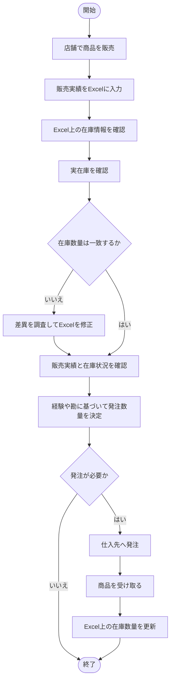

#### 主な業務課題

| 課題ID | 課題             | 発生する業務         |
| ------ | ---------------- | -------------------- |
| BP-001 | 商品の欠品       | 発注判断             |
| BP-002 | 過剰在庫         | 発注判断             |
| BP-003 | 在庫数の不一致   | 売上入力、在庫更新   |
| BP-004 | 発注業務の属人化 | 発注数量の決定       |
| BP-005 | 集計業務の負担   | 売上・在庫情報の確認 |

## 6. 導入後の業務フロー（To-Be）

### 6.1 BF-002：導入後の業務フロー

| 項目         | 内容                                                       |
| ------------ | ---------------------------------------------------------- |
| 目的         | StockPilotを利用した日常業務の全体像を定義する             |
| 主担当者     | 店舗スタッフ、在庫管理担当者、発注担当者、店長             |
| 開始条件     | システム導入および初期在庫登録が完了している               |
| 終了条件     | 当日の販売実績登録、発注判断および必要な入荷処理が完了する |
| 関連業務要件 | BR-001〜BR-011                                             |

#### 業務フロー図

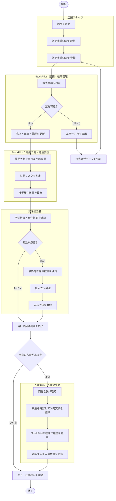

本図は業務全体の関係を示す概念的なフローである。

実際の販売、入荷および発注判断は必ずしも図の順序どおりに発生するものではなく、それぞれ独立した業務として実行できる。

需要予測に必要なデータが不足している場合や予測処理に失敗した場合は、BF-009およびBF-010で定義する例外処理に従う。

また、v0.1.0では需要予測、発注提案および入荷予定管理を対象外とする。

### 6.2 導入前後の比較

| 業務           | As-Is                  | To-Be                              |
| -------------- | ---------------------- | ---------------------------------- |
| 商品管理       | Excelによる個別管理    | 商品マスタによる一元管理           |
| 販売実績登録   | 手入力                 | CSVによる一括登録                  |
| 在庫更新       | 手作業                 | 販売・入荷実績に基づく更新         |
| 在庫履歴       | 十分に管理されていない | 在庫変動履歴を保持                 |
| 売上・在庫集計 | Excelによる集計        | ダッシュボードによる可視化         |
| 需要把握       | 経験や勘               | 過去の販売実績に基づく需要予測     |
| 発注判断       | 担当者の経験に依存     | 予測需要と在庫情報に基づく判断支援 |
| 入荷予定       | 個別管理               | 未入荷数量と予定日の管理           |

## 7. 個別業務フロー

### 7.1 BF-003：システム導入・初期在庫登録

| 項目           | 内容                                                                            |
| -------------- | ------------------------------------------------------------------------------- |
| 目的           | 日常業務を開始するための初期データを整備する                                    |
| 主担当者       | 在庫管理担当者                                                                  |
| 開始条件       | StockPilotを利用できる状態である                                                |
| 終了条件       | 対象商品の初期在庫登録が完了する                                                |
| 関連業務要件   | BR-001, BR-002, BR-003, BR-004                                                  |
| 関連業務ルール | BRL-001, BRL-002, BRL-003, BRL-004, BRL-012, BRL-014, BRL-015, BRL-025, BRL-028 |

#### 業務フロー図

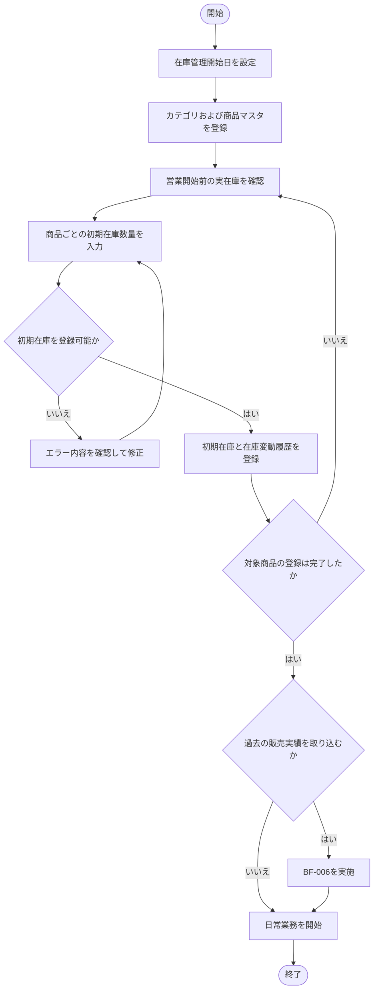

#### 正常系

1. 在庫管理開始日を設定する。
2. カテゴリおよび商品マスタを登録する。
3. 在庫管理開始日の営業開始前の実在庫を確認する。
4. 商品ごとの初期在庫数量を登録する。
5. 初期在庫登録に対応する在庫変動履歴を記録する。
6. 必要に応じて過去の販売実績を取り込む。
7. 日常業務を開始する。

#### 例外系

| 例外                       | 対応                                 |
| -------------------------- | ------------------------------------ |
| 商品が未登録               | 商品マスタを登録してから再実行する   |
| 初期在庫数量が不正         | 登録を拒否し、入力内容を修正する     |
| 初期在庫が登録済み         | 二重登録を拒否する                   |
| 初期在庫登録後に誤りが判明 | BF-008の在庫調整によって訂正する     |
| 初期在庫が未登録           | 当該商品の通常の在庫変動を開始しない |

#### 業務上の補足

初期在庫数量が0の場合も、初期在庫登録が完了したことを識別できるようにする。

在庫管理開始日は、通常の販売実績と過去の販売実績を区別するための基準日として使用する。

在庫変動の登録開始後は、在庫管理開始日を通常操作によって変更できないものとする。

新規取扱商品については、取扱開始時の初期在庫数量を登録してから通常業務を開始する。

### 7.2 BF-004：商品マスタ管理

| 項目           | 内容                                       |
| -------------- | ------------------------------------------ |
| 目的           | 商品情報を一元管理する                     |
| 主担当者       | 在庫管理担当者                             |
| 開始条件       | 商品情報の登録・変更・取扱停止が必要である |
| 終了条件       | 商品情報の更新または取扱停止が完了する     |
| 関連業務要件   | BR-001                                     |
| 関連業務ルール | BRL-002, BRL-008, BRL-016, BRL-023         |

#### 業務フロー図

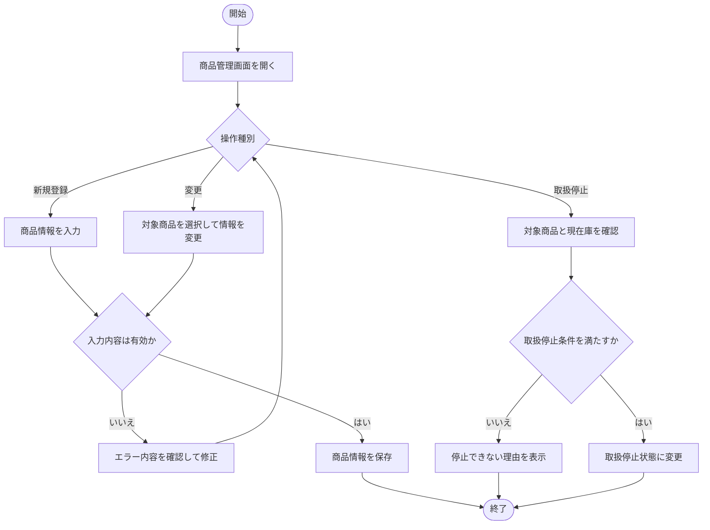

#### 正常系

1. 商品管理画面を開く。
2. 新規登録、変更または取扱停止を選択する。
3. 必要な商品情報を入力する。
4. システムが入力内容および業務ルールを検証する。
5. 商品情報または取扱状態を更新する。

#### 例外系

| 例外                     | 対応                         |
| ------------------------ | ---------------------------- |
| 商品コードが重複している | 登録を拒否する               |
| 必須項目が未入力         | 登録を拒否する               |
| 販売価格・仕入価格が不正 | 登録を拒否する               |
| 現在庫が残っている       | 取扱停止を拒否する           |
| 未入荷数量が残っている   | 取扱停止を拒否する           |
| 取引履歴が存在する       | 履歴を保持し、物理削除しない |

#### 業務上の補足

初期リリースでは商品情報の物理削除を行わず、取扱停止によって管理する。

取扱停止後も過去の販売実績および在庫変動履歴を参照できるものとする。

### 7.3 BF-005：通常の販売実績登録

| 項目           | 内容                                                                                              |
| -------------- | ------------------------------------------------------------------------------------------------- |
| 目的           | 日常の販売実績を登録し、現在庫に反映する                                                          |
| 主担当者       | 店舗スタッフ                                                                                      |
| 開始条件       | 対象商品の初期在庫登録が完了している                                                              |
| 終了条件       | 販売実績、現在庫および在庫変動履歴が更新される                                                    |
| 関連業務要件   | BR-002, BR-003, BR-004                                                                            |
| 関連業務ルール | BRL-003, BRL-004, BRL-005, BRL-007, BRL-012, BRL-015, BRL-016, BRL-017, BRL-024, BRL-027, BRL-028 |

#### 業務フロー図

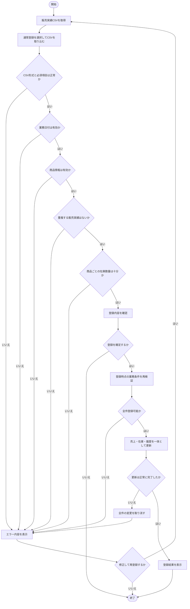

#### 正常系

1. 販売実績CSVを取得する。
2. 通常登録を選択し、CSVを取り込む。
3. システムがCSV形式、業務日付、商品情報および重複の有無を検証する。
4. 商品ごとの販売数量を集計し、在庫不足が発生しないことを確認する。
5. 担当者が登録内容を確認し、登録を確定する。
6. 登録時点の業務条件を再検証する。
7. 販売実績、現在庫および在庫変動履歴を一体として更新する。
8. 登録結果を表示する。

#### 例外系

| 例外                                 | 対応                               |
| ------------------------------------ | ---------------------------------- |
| CSV形式が不正                        | 全件の登録を拒否する               |
| 必須項目が不足                       | 全件の登録を拒否する               |
| 商品コードが存在しない               | 全件の登録を拒否する               |
| 初期在庫が未登録                     | 全件の登録を拒否する               |
| 販売実績が重複している               | 全件の登録を拒否する               |
| 在庫管理開始日前の販売実績が含まれる | 過去データ登録を案内する           |
| 未来の業務日付が含まれる             | 全件の登録を拒否する               |
| 取扱停止商品が含まれる               | 全件の登録を拒否する               |
| 販売数量が現在庫を超える             | 全件の登録を拒否する               |
| 登録確定前に在庫状況が変化した       | 再検証し、登録不可の場合は拒否する |
| 更新処理中に障害が発生               | 全件の変更を取り消す               |

#### 業務上の補足

CSVの一括登録は全件成功または全件失敗とする。

同一商品がCSV内に複数行存在する場合は、販売数量の合計を考慮して在庫数量を検証する。

在庫不足が発生した場合は、入荷実績の登録漏れや実在庫との差異などを調査し、必要な業務処理を実施してから再登録する。

販売実績を登録するためだけに、根拠のない在庫調整を行ってはならない。

### 7.4 BF-006：過去の販売実績登録

| 項目           | 内容                                               |
| -------------- | -------------------------------------------------- |
| 目的           | 売上分析および需要予測に必要な過去データを整備する |
| 主担当者       | 在庫管理担当者                                     |
| 開始条件       | 商品マスタおよび在庫管理開始日が設定されている     |
| 終了条件       | 過去の販売実績が登録され、現在庫は変更されない     |
| 関連業務要件   | BR-004, BR-006                                     |
| 関連業務ルール | BRL-007, BRL-012, BRL-014, BRL-024, BRL-027        |

#### 業務フロー図

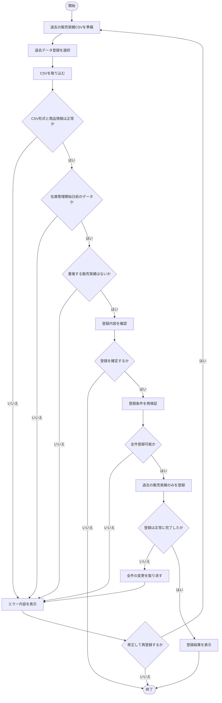

#### 正常系

1. 在庫管理開始日前の販売実績CSVを準備する。
2. 過去データ登録を選択する。
3. CSVを取り込み、入力内容を検証する。
4. 担当者が登録内容を確認する。
5. 過去の販売実績を登録する。
6. 登録結果を表示する。

#### 例外系

| 例外                                 | 対応                 |
| ------------------------------------ | -------------------- |
| CSV形式が不正                        | 全件の登録を拒否する |
| 商品コードが存在しない               | 全件の登録を拒否する |
| 販売実績が重複している               | 全件の登録を拒否する |
| 在庫管理開始日以降のデータが含まれる | 通常登録を案内する   |
| 更新処理中に障害が発生               | 全件の変更を取り消す |

#### 業務上の補足

過去データ登録では現在庫を変更せず、販売に対応する在庫変動履歴も作成しない。

取扱停止商品についても、過去の取引事実を保持するため、在庫管理開始日前の販売実績を登録できるものとする。

### 7.5 BF-007：入荷実績登録

| 項目           | 内容                                                     |
| -------------- | -------------------------------------------------------- |
| 目的           | 実際に入荷した商品を現在庫に反映する                     |
| 主担当者       | 在庫管理担当者、店舗スタッフ                             |
| 開始条件       | 商品が実際に入荷している                                 |
| 終了条件       | 現在庫、入荷履歴および必要に応じて未入荷数量が更新される |
| 関連業務要件   | BR-002, BR-003, BR-011                                   |
| 関連業務ルール | BRL-004, BRL-006, BRL-015, BRL-020, BRL-028              |

#### 業務フロー図

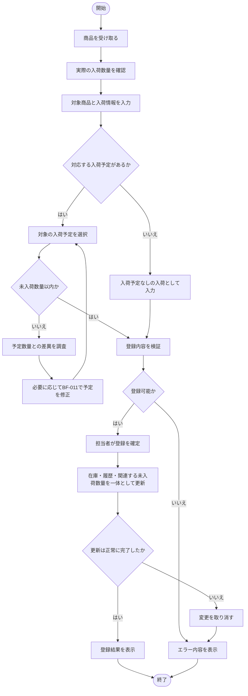

#### 正常系

1. 商品を受け取り、実際の入荷数量を確認する。
2. 対象商品、入荷数量および入荷日を入力する。
3. 対応する入荷予定がある場合は、その予定を選択する。
4. システムが入力内容を検証する。
5. 担当者が登録を確定する。
6. 現在庫を増加させ、入荷履歴を記録する。
7. 入荷予定と関連付けられている場合は、未入荷数量を減少させる。
8. 登録結果を表示する。

#### 例外系

| 例外                              | 対応                                     |
| --------------------------------- | ---------------------------------------- |
| 商品が存在しない                  | 登録を拒否する                           |
| 初期在庫が未登録                  | 初期在庫登録を案内する                   |
| 取扱停止商品である                | 登録を拒否する                           |
| 入荷数量が0以下または整数ではない | 登録を拒否する                           |
| 未入荷数量を超える入荷            | 差異を調査し、必要に応じて予定を修正する |
| 取消済みの入荷予定が指定された    | 登録を拒否する                           |
| 入荷完了済みの予定が指定された    | 登録を拒否する                           |
| 更新処理中に障害が発生            | 関連する変更をすべて取り消す             |

#### リリースごとの取り扱い

v0.1.0では入荷予定との関連付けを行わず、入荷実績、現在庫および在庫変動履歴を管理する。

v1.0.0では入荷予定との関連付けおよび未入荷数量の更新に対応する。

対応する入荷予定が存在しない場合も、実際の入荷事実を登録できるものとする。

### 7.6 BF-008：在庫調整

| 項目           | 内容                                                 |
| -------------- | ---------------------------------------------------- |
| 目的           | 実在庫とシステム上の在庫数量の差異を訂正する         |
| 主担当者       | 在庫管理担当者                                       |
| 開始条件       | 在庫差異、廃棄、破損などが確認されている             |
| 終了条件       | 在庫数量が調整され、調整履歴が記録される             |
| 関連業務要件   | BR-002, BR-003                                       |
| 関連業務ルール | BRL-003, BRL-004, BRL-013, BRL-015, BRL-018, BRL-028 |

#### 業務フロー図

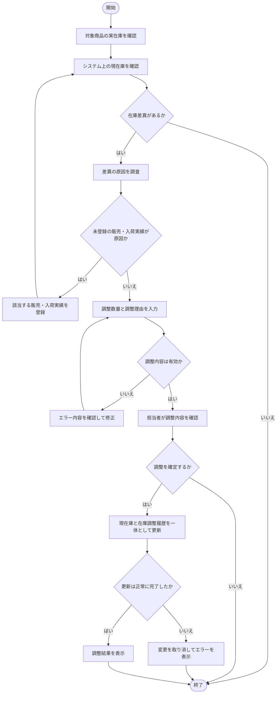

#### 正常系

1. 実在庫とシステム上の現在庫を確認する。
2. 在庫差異の原因を調査する。
3. 調整が必要な場合は、調整数量および調整理由を入力する。
4. システムが調整内容を検証する。
5. 担当者が調整を確定する。
6. 現在庫を更新し、在庫調整履歴を記録する。

#### 例外系

| 例外                           | 対応                               |
| ------------------------------ | ---------------------------------- |
| 調整理由が未入力               | 登録を拒否する                     |
| 調整数量が不正                 | 登録を拒否する                     |
| 調整後の在庫数量が負になる     | 登録を拒否する                     |
| 調整確定前に在庫数量が変化した | 最新の在庫状況を確認して再検証する |
| 更新処理中に障害が発生         | 関連する変更をすべて取り消す       |

#### 業務上の補足

在庫調整は過去の在庫変動履歴を直接変更するものではない。

販売実績の登録漏れや入荷実績の登録漏れが原因である場合は、該当する業務処理を優先する。

在庫調整によって販売実績や売上金額を直接変更しない。

### 7.7 BF-009：需要予測

| 項目           | 内容                                         |
| -------------- | -------------------------------------------- |
| 目的           | 商品ごとの将来需要を予測する                 |
| 主担当者       | StockPilot、発注担当者                       |
| 開始条件       | 商品情報および販売実績が登録されている       |
| 終了条件       | 需要予測結果または予測不可の理由を確認できる |
| 関連業務要件   | BR-006                                       |
| 関連業務ルール | BRL-011, BRL-012, BRL-022                    |

#### 業務フロー図

#### 正常系

1. 予測対象商品および予測基準日を決定する。
2. 予測基準日までの利用可能な販売実績を取得する。
3. 予測に必要なデータが充足していることを確認する。
4. 商品別・日別の需要予測を実行する。
5. 予測結果の妥当性を確認する。
6. 予測基準日の翌日から14日間の予測結果を保存する。
7. 予測結果を利用者が参照できる状態にする。

#### 例外系

| 例外                             | 対応                           |
| -------------------------------- | ------------------------------ |
| 販売実績が不足している           | データ不足であることを表示する |
| 予測対象商品が取扱停止状態である | 予測対象から除外する           |
| 予測に必要なデータが不正         | 当該商品の予測を成立させない   |
| 予測処理が失敗した               | 失敗を記録し、利用者に通知する |
| 予測結果が不正                   | 有効な予測結果として公開しない |

#### 業務上の補足

需要予測において、予測基準日より後の情報を利用してはならない。

予測結果には予測基準日、対象期間および予測結果の有効性を判断するための情報を含める。

一部の商品で予測に失敗した場合でも、正常に予測できた商品の結果は利用可能とする。

最低データ量、代替予測手法、予測結果の有効期間および実行頻度は後続工程で具体化する。

### 7.8 BF-010：欠品リスク確認・発注判断

| 項目           | 内容                                                 |
| -------------- | ---------------------------------------------------- |
| 目的           | 欠品および過剰在庫を抑制するための発注判断を支援する |
| 主担当者       | 発注担当者、店長                                     |
| 開始条件       | 商品情報、現在庫および必要な需要予測結果が存在する   |
| 終了条件       | 担当者による発注判断が完了する                       |
| 関連業務要件   | BR-007, BR-008, BR-009, BR-011                       |
| 関連業務ルール | BRL-009, BRL-010, BRL-011, BRL-016, BRL-021, BRL-026 |

#### 業務フロー図

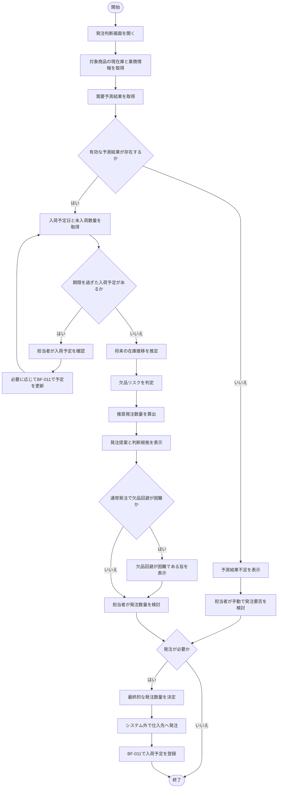

#### 正常系

1. 発注担当者が発注判断画面を開く。
2. 商品ごとの現在庫、需要予測および入荷予定を取得する。
3. 調達リードタイム、発注間隔および安全在庫を確認する。
4. システムが将来の在庫推移を推定する。
5. 欠品リスクおよび推奨発注数量を算出する。
6. 発注提案および算出根拠を表示する。
7. 担当者が提案内容を確認する。
8. 担当者が最終的な発注数量を決定する。
9. 発注が必要な場合は、システム外で仕入先へ発注する。
10. 発注済み商品の入荷予定を登録する。

#### 例外系

| 例外                                 | 対応                                         |
| ------------------------------------ | -------------------------------------------- |
| 有効な予測結果が存在しない           | 予測結果不足を表示し、手動判断を案内する     |
| 調達リードタイムが未設定             | 当該商品の発注提案を成立させない             |
| 安全在庫が未設定                     | 当該商品の発注提案を成立させない             |
| 入荷予定日を過ぎている               | 入荷状況の確認および予定の見直しを案内する   |
| 調達リードタイム内に欠品が予想される | 通常発注では欠品回避が困難である旨を表示する |
| 推奨発注数量が0                      | 発注不要である旨を表示する                   |
| 取扱停止商品である                   | 発注提案の対象から除外する                   |

#### 業務上の補足

発注提案は原則として1日1回の発注判断を想定する。

入荷予定数量は、対象期間内の有効な未入荷数量を考慮する。

入荷予定日を過ぎた未入荷数量については、確実な入荷として扱わない。

予測結果が存在しない場合に、予測需要を0として発注数量を算出してはならない。

発注提案の確認および発注判断によって現在庫を変更しない。

StockPilotは仕入先への発注処理を実行しない。

### 7.9 BF-011：入荷予定管理

| 項目           | 内容                                             |
| -------------- | ------------------------------------------------ |
| 目的           | 発注済み商品の入荷予定および未入荷数量を管理する |
| 主担当者       | 発注担当者                                       |
| 開始条件       | 発注済み商品または登録済みの入荷予定が存在する   |
| 終了条件       | 入荷予定の登録・変更・取消が完了する             |
| 関連業務要件   | BR-011                                           |
| 関連業務ルール | BRL-019, BRL-020, BRL-026                        |

#### 業務フロー図

#### 正常系

1. 発注担当者が入荷予定管理画面を開く。
2. 新規登録、変更または取消を選択する。
3. 対象商品、入荷予定日および予定数量を確認する。
4. システムが入力内容および現在の入荷状況を検証する。
5. 入荷予定を登録、更新または取り消す。
6. 処理結果を表示する。

#### 例外系

| 例外                                   | 対応                         |
| -------------------------------------- | ---------------------------- |
| 商品が存在しない                       | 登録を拒否する               |
| 取扱停止商品である                     | 新規登録を拒否する           |
| 予定数量が不正                         | 登録を拒否する               |
| 新規登録時の予定日が過去の日付である   | 登録を拒否する               |
| 変更後の予定数量が入荷済み数量を下回る | 変更を拒否する               |
| 入荷完了済みの予定である               | 変更・取消を拒否する         |
| 取消済みの予定である                   | 変更・再取消を拒否する       |
| 入荷予定日を過ぎている                 | 遅延状態として確認を案内する |

#### 入荷予定の状態遷移

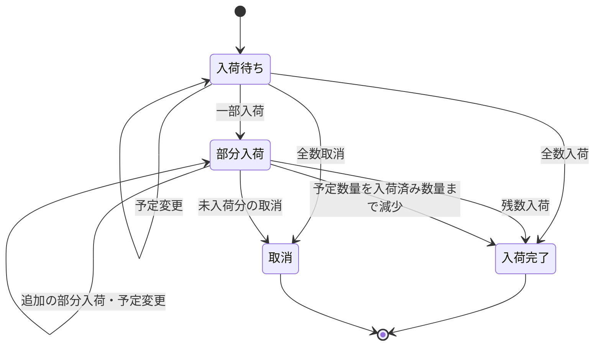

#### 状態の定義

| 状態     | 定義                                   |
| -------- | -------------------------------------- |
| 入荷待ち | 入荷実績がなく、未入荷数量が存在する   |
| 部分入荷 | 一部が入荷済みで、未入荷数量が存在する |
| 入荷完了 | 有効な予定数量のすべてが入荷済みである |
| 取消     | 未入荷分が取り消されている             |

入荷遅延は独立した状態遷移ではなく、入荷予定日と未入荷数量から判定する付加的な状態とする。

#### 業務上の補足

入荷予定の登録、変更および取消によって現在庫を変更しない。

部分入荷後に未入荷分を取り消した場合も、すでに入荷した数量および入荷履歴を保持する。

入荷完了済みおよび取消済みの予定は発注提案の計算対象外とする。

### 7.10 BF-012：売上・在庫状況の確認・分析

| 項目           | 内容                                           |
| -------------- | ---------------------------------------------- |
| 目的           | 売上および在庫状況を把握し、店舗運営に利用する |
| 主担当者       | 店長、在庫管理担当者                           |
| 開始条件       | 商品情報または販売・在庫データが登録されている |
| 終了条件       | 対象期間および対象商品の状況を確認できる       |
| 関連業務要件   | BR-005                                         |
| 関連業務ルール | BRL-012, BRL-023                               |

#### 業務フロー図

#### 正常系

1. ダッシュボードまたは分析画面を開く。
2. 対象期間や対象商品などを指定する。
3. システムが必要なデータを取得する。
4. 売上金額、販売数量、現在庫数量および在庫金額などを集計する。
5. 集計結果を可視化する。
6. 担当者が店舗運営上の判断に利用する。

#### 例外系

| 例外                   | 対応                             |
| ---------------------- | -------------------------------- |
| 対象データが存在しない | データが存在しない旨を表示する   |
| 対象期間の指定が不正   | 入力内容の修正を案内する         |
| 集計処理が失敗した     | エラーを表示し、再実行を案内する |

#### リリースごとの取り扱い

v0.1.0では基本的な売上・在庫指標をダッシュボードで確認できるものとする。

v1.0.0では売上推移や商品別の販売傾向など、詳細な分析に対応する。

データが存在しない状態と、実績値が0である状態を区別する。

現在庫を表示する指標と、指定期間の売上を表示する指標については、対象時点または対象期間を明示する。

### 7.11 BF-013：需要予測・業務改善効果の評価

| 項目         | 内容                                                     |
| ------------ | -------------------------------------------------------- |
| 目的         | 需要予測モデルの精度および業務改善効果を定量的に評価する |
| 主担当者     | 開発・分析担当者                                         |
| 開始条件     | 評価用データおよび比較対象となる方式が準備されている     |
| 終了条件     | 評価結果、評価条件および検証上の限界が記録される         |
| 関連業務要件 | BR-010                                                   |
| 関連KPI      | KPI-001〜KPI-004                                         |

#### 業務フロー図

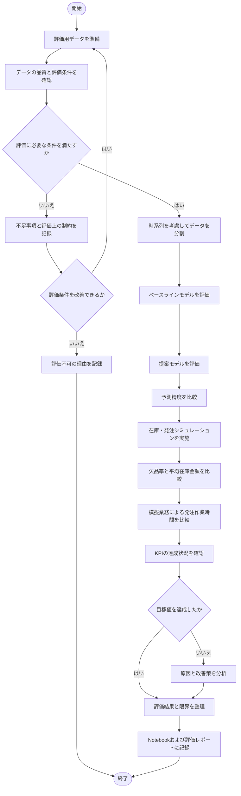

#### 正常系

1. 評価用データを準備する。
2. データ品質および評価条件を確認する。
3. 時系列を考慮して学習用データと評価用データを分割する。
4. ベースラインモデルと提案モデルの予測精度を評価する。
5. 同一条件下で在庫・発注シミュレーションを実施する。
6. 欠品率および平均在庫金額を比較する。
7. 模擬業務によって発注作業時間を比較する。
8. KPIの達成状況を確認する。
9. 評価結果および検証上の限界を記録する。

#### 例外系

| 例外                         | 対応                                   |
| ---------------------------- | -------------------------------------- |
| 評価用データが不足している   | 不足内容および評価上の制約を記録する   |
| 比較条件が一致していない     | 比較条件を見直して再評価する           |
| データリークが確認された     | 評価結果を無効とし、評価方法を修正する |
| KPIの目標値を達成できない    | 原因および改善策を記録する             |
| 実際の需要数量を把握できない | 評価結果の解釈上の制約を明記する       |

#### 業務上の補足

評価結果は実際の企業への導入効果を示すものではない。

需要予測精度の改善が必ずしも業務改善につながるとは限らないため、予測精度と業務上の効果をそれぞれ評価する。

実際の需要数量が取得できない場合は、合成データなどを使用した評価方法を検討する。

評価結果が目標値に達しなかった場合も、評価条件、結果および改善策を記録する。

## 8. 業務とデータ更新の対応関係

### 8.1 データ更新一覧

| 業務フロー             | 商品情報 | 販売実績 | 現在庫 | 在庫変動履歴 | 入荷予定     | 需要予測結果 |
| ---------------------- | -------- | -------- | ------ | ------------ | ------------ | ------------ |
| BF-003：初期導入       | 更新     | ―        | 更新   | 追加         | ―            | ―            |
| BF-004：商品管理       | 更新     | ―        | ―      | ―            | ―            | ―            |
| BF-005：通常販売登録   | ―        | 追加     | 減少   | 追加         | ―            | ―            |
| BF-006：過去データ登録 | ―        | 追加     | ―      | ―            | ―            | ―            |
| BF-007：入荷実績登録   | ―        | ―        | 増加   | 追加         | 条件付き更新 | ―            |
| BF-008：在庫調整       | ―        | ―        | 増減   | 追加         | ―            | ―            |
| BF-009：需要予測       | ―        | ―        | ―      | ―            | ―            | 更新         |
| BF-010：発注判断       | ―        | ―        | ―      | ―            | ―            | ―            |
| BF-011：入荷予定管理   | ―        | ―        | ―      | ―            | 更新         | ―            |
| BF-012：売上・在庫分析 | ―        | ―        | ―      | ―            | ―            | ―            |
| BF-013：効果検証       | ―        | ―        | ―      | ―            | ―            | ―            |

本表は各業務フローが直接更新する主要な業務データを示す。

他の業務フローを呼び出した場合のデータ更新については、呼び出し先の業務フローに従う。

### 8.2 データ整合性の維持

以下のデータ更新は一体として成立するものとする。

| 業務               | 一体として成立させるデータ更新           |
| ------------------ | ---------------------------------------- |
| 初期在庫登録       | 初期在庫、在庫変動履歴                   |
| 通常の販売実績登録 | 販売実績、現在庫、在庫変動履歴           |
| 入荷実績登録       | 現在庫、在庫変動履歴、関連する未入荷数量 |
| 在庫調整           | 現在庫、在庫変動履歴                     |

関連するデータ更新の一部のみが成立することを認めない。

更新処理が失敗した場合は、当該処理による変更をすべて取り消す。

## 9. 例外処理方針

### 9.1 CSV一括登録

通常の販売実績登録および過去の販売実績登録では、全件成功または全件失敗の方式を採用する。

CSV内に登録できないデータが1件以上存在する場合は、当該CSVのすべての登録を拒否する。

担当者がエラーの原因を特定できるように、可能な範囲で対象行、対象項目およびエラー理由を提示する。

### 9.2 販売実績の登録区分

在庫管理開始日を基準として、販売実績を以下のように区分する。

| 区分           | 対象業務日付       | 現在庫への反映 |
| -------------- | ------------------ | -------------- |
| 通常登録       | 在庫管理開始日以降 | あり           |
| 過去データ登録 | 在庫管理開始日前   | なし           |

未来の業務日付を持つ販売実績は、いずれの区分でも登録できない。

1つのCSVに両方の登録区分に該当する販売実績が含まれる場合は、登録を拒否し、担当者にデータの分割を案内する。

### 9.3 在庫不足

通常の販売実績登録または在庫調整によって現在庫が負になる場合は、当該処理を成立させない。

担当者は入荷実績の登録漏れ、販売実績の重複、実在庫との差異などを調査する。

### 9.4 重複登録

同一の販売実績を重複して登録してはならない。

通常登録と過去データ登録をまたいだ重複についても防止する。

入荷実績や在庫調整についても、通信障害や操作の繰り返しによる意図しない二重登録を防止する。

具体的な識別方法および再送時の取り扱いは機能要件定義および基本設計で定義する。

### 9.5 部分入荷および入荷予定の取消

予定数量の一部のみが入荷した場合は、実際に入荷した数量だけを現在庫に加算する。

残りの未入荷数量は入荷予定として管理する。

未入荷分が取り消された場合は、取消分を発注提案の計算対象から除外する。

すでに登録された入荷実績および在庫変動履歴は保持する。

### 9.6 需要予測データ不足

需要予測に必要なデータが不足している場合は、その旨を利用者に提示する。

予測結果が存在しない状態を、予測需要が0である状態として扱わない。

有効な予測結果を取得できない場合は、根拠のない発注提案を行わず、担当者による手動判断を案内する。

### 9.7 システム障害

処理中にシステム障害が発生した場合は、不整合な業務データを残さない。

利用者が処理の成功・失敗を確認できるようにする。

処理結果が不明な場合は、登録済みデータを確認してから再実行する。

## 10. 業務要件との対応関係

| 業務要件ID | 業務要件                     | 主な関連業務フロー                     |
| ---------- | ---------------------------- | -------------------------------------- |
| BR-001     | 商品情報の一元管理           | BF-003, BF-004                         |
| BR-002     | 現在庫の把握                 | BF-003, BF-005, BF-007, BF-008, BF-012 |
| BR-003     | 入出庫履歴の把握             | BF-003, BF-005, BF-007, BF-008         |
| BR-004     | 販売実績の効率的な登録       | BF-005, BF-006                         |
| BR-005     | 売上・在庫状況の可視化       | BF-012                                 |
| BR-006     | 将来の商品需要の予測         | BF-006, BF-009                         |
| BR-007     | 欠品リスクの把握             | BF-010                                 |
| BR-008     | 発注数量の提案               | BF-010                                 |
| BR-009     | 発注判断の根拠の確認         | BF-010                                 |
| BR-010     | 需要予測と業務改善効果の評価 | BF-013                                 |
| BR-011     | 入荷予定の把握               | BF-007, BF-010, BF-011                 |

詳細な機能要件およびテストケースとの対応関係は、後続の要件トレーサビリティマトリクスで管理する。

## 11. 未決事項

| ID         | 未決事項                                         | 決定予定工程                 |
| ---------- | ------------------------------------------------ | ---------------------------- |
| BF-TBD-001 | CSVの項目、形式および登録可能件数                | 機能要件定義・非機能要件定義 |
| BF-TBD-002 | 販売実績の具体的な重複判定方法                   | 機能要件定義                 |
| BF-TBD-003 | 登録済み販売実績の訂正手順                       | 機能要件定義                 |
| BF-TBD-004 | 需要予測の実行頻度および結果の有効期間           | 機能要件定義・基本設計       |
| BF-TBD-005 | 需要予測に必要な最低データ量                     | データ分析・需要予測         |
| BF-TBD-006 | 予測データ不足時の代替予測手法                   | データ分析・需要予測         |
| BF-TBD-007 | 推奨発注数量の具体的な算出方法                   | 機能要件定義・基本設計       |
| BF-TBD-008 | 欠品リスクの具体的な判定基準                     | 機能要件定義                 |
| BF-TBD-009 | 在庫金額の具体的な評価方法                       | 機能要件定義                 |
| BF-TBD-010 | KPIの評価条件および比較方式                      | データ分析・需要予測         |
| BF-TBD-011 | 入荷実績の訂正方法および関連する未入荷数量の扱い | 機能要件定義                 |
| BF-TBD-012 | 同時操作および通信再送時の二重登録防止方法       | 機能要件定義・基本設計       |
| BF-TBD-013 | 過去の業務日付を持つ通常登録・入荷登録の取り扱い | 機能要件定義                 |

業務要件定義書に記載した未決事項についても、引き続き関連する工程で管理する。

## 12. 完了条件

以下の条件を満たすことを業務フロー定義の完了条件とする。

- As-IsおよびTo-Beの業務フローが定義されていること。
- 個別業務フローに一意の識別子が付与されていること。
- 業務フローの開始条件および終了条件が明確であること。
- 利用者とシステムの役割が明確であること。
- 正常系および主要な例外系が定義されていること。
- 業務要件および業務ルールとの対応関係が明確であること。
- 業務とデータ更新の対応関係が明確であること。
- リリースごとの対象範囲が明確であること。
- 未決事項および決定予定工程が明記されていること。
- プロジェクト企画書および業務要件定義書との矛盾がないこと。
- Mermaidによる業務フロー図が正常に表示されること。

## 13. 改訂履歴

| バージョン | 日付       | 変更内容 |
| ---------- | ---------- | -------- |
| 1.0        | 2026-11-27 | 初版作成 |
