# StockPilot 業務フロー定義書

## 1. ドキュメント情報

| 項目             | 内容                                                  |
| ---------------- | ----------------------------------------------------- |
| ドキュメント名   | 業務フロー定義書                                      |
| プロジェクト名   | StockPilot                                            |
| バージョン       | 1.2                                                   |
| 作成日           | 2026-11-27                                            |
| 最終更新日       | 2026-11-27                                            |
| 対象工程         | Phase 1：要件定義                                     |
| 関連ドキュメント | [プロジェクト企画書](../planning/project-proposal.md) |
| 関連ドキュメント | [業務要件定義書](./business-requirements.md)          |
| 関連ドキュメント | [機能要件定義書](./functional-requirements.md)        |

## 2. 本書の目的

本書は、プロジェクト企画書および業務要件定義書に基づき、StockPilotの導入前後における業務フローを定義することを目的とする。

個別業務における利用者とシステムの役割、業務手順、開始条件、終了条件、データ更新および例外発生時の対応を明確にする。

本書で定義した業務フローは、後続の機能要件定義、非機能要件定義、基本設計およびテストの基礎とする。

なお、本書の業務フローは架空の顧客企業を想定したものであり、実際の企業への業務調査やヒアリングに基づくものではない。

## 3. 業務フローの表記ルール

### 3.1 識別子

各業務フローには `BF-XXX` 形式の一意の識別子を付与する。

関連する業務要件および業務ルールの識別子を記載し、後続工程とのトレーサビリティを確保する。

一度付与した識別子は、原則として変更または再利用しない。

既存の業務フローを具体化する場合は、識別子を維持したまま内容を更新する。

業務上独立した手順として管理する必要がある場合は、新たな識別子を付与する。

関連する機能要件との詳細な対応関係は、機能要件定義書および要件トレーサビリティマトリクスで管理する。

### 3.2 フロー図の表記

業務フロー図にはMermaidを使用する。

| 表記           | 意味                       |
| -------------- | -------------------------- |
| 角丸のノード   | 業務の開始・終了           |
| 長方形のノード | 業務処理・システム処理     |
| ひし形のノード | 条件分岐・判断             |
| 矢印           | 処理の流れ                 |
| サブグラフ     | 担当者または処理主体の区分 |

### 3.3 処理主体

| 処理主体           | 主な役割                                               |
| ------------------ | ------------------------------------------------------ |
| 店長               | 売上・在庫状況の確認、業務判断                         |
| 在庫管理担当者     | 商品管理、初期在庫登録、入荷登録、在庫調整             |
| 発注担当者         | 需要予測の確認、発注判断、入荷予定管理                 |
| 店舗スタッフ       | 販売実績および入荷実績の登録                           |
| StockPilot         | データ管理、検証、集計、需要予測、発注提案             |
| 仕入先             | 商品の供給                                             |
| 開発・分析担当者   | 予測モデルおよび業務改善効果の評価                     |
| システム運用担当者 | 利用アカウントの準備、システムの初期導入および運用管理 |

上記は業務上の役割を示すものであり、システム上のアクセス権限を定義するものではない。

### 3.4 共通の業務開始条件

利用者向けWebアプリケーション上の業務機能を利用する場合は、事前に準備された利用アカウントによる認証が完了していることを前提とする。

未認証の場合は、ログインを案内する。

認証状態が無効となった場合は、業務データの参照および更新を認めない。

個別業務フローでは、特に必要な場合を除き、ログインおよび認証状態の確認手順を省略する。

業務上の役割はシステム上のアクセス権限区分を示すものではない。

BF-001およびWebアプリケーション外で実施するBF-013については、上記の認証条件を適用しない。

## 4. 業務フロー一覧

| ID     | 業務フロー                   | 関連業務要件                   | 対象リリース    |
| ------ | ---------------------------- | ------------------------------ | --------------- |
| BF-001 | 現状の業務フロー（As-Is）    | ―                              | 対象外          |
| BF-002 | 導入後の業務フロー（To-Be）  | BR-001〜BR-011                 | v1.0.0完成時    |
| BF-003 | システム導入・初期在庫登録   | BR-001, BR-002, BR-003, BR-004 | v0.1.0          |
| BF-004 | 商品マスタ管理               | BR-001                         | v0.1.0 / v1.0.0 |
| BF-005 | 通常の販売実績登録           | BR-002, BR-003, BR-004         | v0.1.0          |
| BF-006 | 過去の販売実績登録           | BR-004, BR-006                 | v0.1.0          |
| BF-007 | 入荷実績登録                 | BR-002, BR-003, BR-011         | v0.1.0 / v1.0.0 |
| BF-008 | 在庫調整                     | BR-002, BR-003                 | v0.1.0          |
| BF-009 | 需要予測                     | BR-006                         | v1.0.0          |
| BF-010 | 欠品リスク確認・発注判断     | BR-007, BR-008, BR-009, BR-011 | v1.0.0          |
| BF-011 | 入荷予定管理                 | BR-011                         | v1.0.0          |
| BF-012 | 売上・在庫状況の確認・分析   | BR-005                         | v0.1.0 / v1.0.0 |
| BF-013 | 需要予測・業務改善効果の評価 | BR-010                         | v1.0.0          |
| BF-014 | 販売実績訂正                 | BR-002, BR-003, BR-004         | v0.1.0          |
| BF-015 | 入荷実績訂正                 | BR-002, BR-003, BR-011         | v0.1.0 / v1.0.0 |

BF-001はStockPilot導入前の業務フローである。

BF-002はStockPilot導入後の業務全体を示す上位業務フローである。

BF-013はWebアプリケーション上の業務機能ではなく、開発・分析担当者による評価作業を対象とする。

BF-014およびBF-015は、登録済み業務データの入力誤りに対応するための業務フローである。

各リリースの対象範囲は、業務要件定義書および機能要件定義書に従う。

## 5. 現状の業務フロー（As-Is）

### 5.1 BF-001：現状の業務フロー

| 項目     | 内容                                                              |
| -------- | ----------------------------------------------------------------- |
| 目的     | 現状の業務手順および課題を把握する                                |
| 主担当者 | 店舗スタッフ、在庫管理担当者、発注担当者                          |
| 開始条件 | 店舗で日常の販売業務が行われる                                    |
| 終了条件 | 発注不要と判断するか、商品の入荷およびExcel上の在庫更新が完了する |
| 関連課題 | BP-001〜BP-005                                                    |

#### 業務フロー図

#### 主な業務課題

| 課題ID | 課題             | 発生する業務         |
| ------ | ---------------- | -------------------- |
| BP-001 | 商品の欠品       | 発注判断             |
| BP-002 | 過剰在庫         | 発注判断             |
| BP-003 | 在庫数の不一致   | 売上入力、在庫更新   |
| BP-004 | 発注業務の属人化 | 発注数量の決定       |
| BP-005 | 集計業務の負担   | 売上・在庫情報の確認 |

## 6. 導入後の業務フロー（To-Be）

### 6.1 BF-002：導入後の業務フロー

| 項目         | 内容                                                         |
| ------------ | ------------------------------------------------------------ |
| 目的         | StockPilotを利用した日常業務の全体像を定義する               |
| 主担当者     | 店舗スタッフ、在庫管理担当者、発注担当者、店長               |
| 開始条件     | 利用者の認証が完了し、対象業務に必要な初期設定が完了している |
| 終了条件     | 必要な業務処理および業務判断が完了する                       |
| 関連業務要件 | BR-001〜BR-011                                               |

#### 業務フロー図

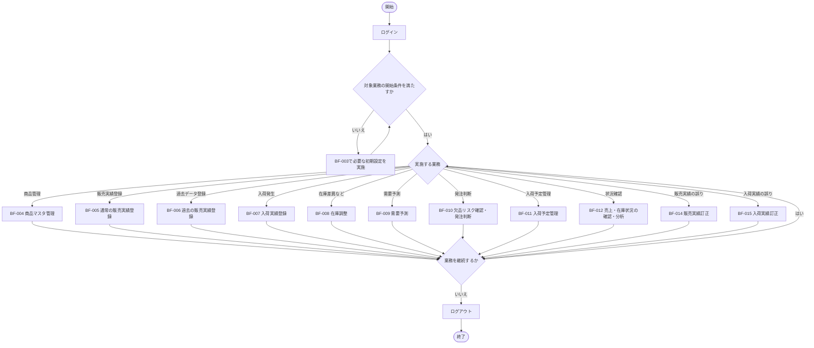

#### 業務上の補足

各業務は、業務上必要となったタイミングで独立して実施する。

対象商品の初期在庫登録が完了している場合は、他の商品が初期在庫未登録であっても、当該商品の業務開始条件を満たす範囲で業務を実施できる。

通常販売実績登録に伴い現在庫を更新する。過去販売実績登録では現在庫を変更しない。

需要予測は利用者による手動実行を基本とし、販売実績登録のたびに自動実行することは必須としない。

発注判断は原則として1日1回行う。

有効な需要予測結果を利用し、欠品リスクおよび推奨発注数量を確認する。

発注提案を利用できない場合は、担当者による手動判断を案内する。

実際の発注は担当者がシステム外で実施する。

発注済み商品の入荷予定はBF-011によって登録する。

実際の入荷が発生した場合はBF-007によって入荷実績を登録する。

登録済み実績に入力誤りが判明した場合は、BF-014またはBF-015によって訂正する。

BF-013は日常業務とは独立した開発・分析担当者による評価業務として実施する。

本フローはv1.0.0完成時の業務全体を示す。

v0.1.0では需要予測、発注提案および入荷予定管理を除いた業務を対象とする。

### 6.2 導入前後の比較

| 業務           | As-Is                         | To-Be                                          |
| -------------- | ----------------------------- | ---------------------------------------------- |
| 商品管理       | Excelによる個別管理           | 商品マスタによる一元管理                       |
| 販売実績登録   | 手入力                        | CSVによる一括登録                              |
| 在庫更新       | 手作業                        | 販売・入荷実績に基づく更新                     |
| 在庫履歴       | 十分に管理されていない        | 在庫変動履歴を保持                             |
| 売上・在庫集計 | Excelによる集計               | ダッシュボードによる可視化                     |
| 需要把握       | 経験や勘                      | 過去の販売実績に基づく需要予測                 |
| 発注判断       | 担当者の経験に依存            | 予測需要と在庫情報に基づく判断支援             |
| 入荷予定       | 個別管理                      | 未入荷数量と予定日の管理                       |
| 実績訂正       | Excel上の登録値を直接修正する | 元の業務記録を保持し、訂正履歴を記録する       |
| 在庫管理開始   | 明確な管理開始日の区分がない  | 店舗単位および商品単位の開始日を管理する       |
| 予測結果の管理 | 担当者の経験や判断に依存する  | 予測結果の有効性および再予測の必要性を確認する |

## 7. 個別業務フロー

### 7.1 BF-003：システム導入・初期在庫登録

| 項目           | 内容                                                                                                                |
| -------------- | ------------------------------------------------------------------------------------------------------------------- |
| 目的           | 日常業務を開始するための利用環境および初期データを整備する                                                          |
| 主担当者       | システム運用担当者、在庫管理担当者                                                                                  |
| 開始条件       | StockPilotを利用できる環境が準備されている                                                                          |
| 終了条件       | 対象商品の初期在庫登録が完了し、対象業務を開始できる                                                                |
| 関連業務要件   | BR-001, BR-002, BR-003, BR-004                                                                                      |
| 関連業務ルール | BRL-001, BRL-002, BRL-003, BRL-004, BRL-012, BRL-015, BRL-025, BRL-028, BRL-030〜BRL-034, BRL-040, BRL-045〜BRL-051 |

#### 業務フロー図

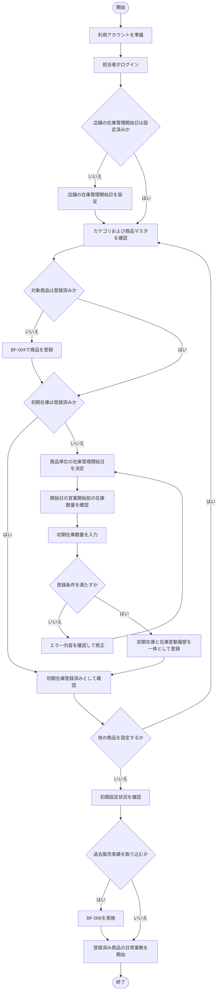

#### 正常系

1. システム運用担当者が利用アカウントを準備する。
2. 在庫管理担当者がログインする。
3. 店舗の在庫管理開始日を設定する。
4. カテゴリおよび商品マスタを登録する。
5. 商品単位の在庫管理開始日を決定する。
6. 当該商品の開始日の営業開始前の在庫数量を確認する。
7. 初期在庫数量を登録する。
8. 初期在庫および在庫変動履歴を一体として登録する。
9. 必要に応じて他の商品についても初期在庫を登録する。
10. 初期設定状況を確認する。
11. 必要に応じて過去販売実績を取り込む。
12. 初期在庫登録済み商品の日常業務を開始する。

#### 例外系

| 例外                                 | 対応                                           |
| ------------------------------------ | ---------------------------------------------- |
| 認証されていない                     | ログインを案内する                             |
| 店舗の在庫管理開始日が未設定         | 店舗の開始日設定を案内する                     |
| 商品が未登録                         | BF-004による商品登録を案内する                 |
| 商品単位の開始日が店舗の開始日より前 | 登録を拒否する                                 |
| 商品単位の開始日が未来の日付         | 登録を拒否する                                 |
| 初期在庫数量が不正                   | 登録を拒否する                                 |
| 初期在庫が登録済み                   | 二重登録を拒否する                             |
| 初期在庫登録後に誤りが判明           | BF-008による在庫調整を案内する                 |
| 取扱停止商品である                   | 新規の初期在庫登録を拒否する                   |
| 初期在庫が未登録                     | 当該商品の在庫変動および販売実績登録を認めない |

#### 業務上の補足

店舗の在庫管理開始日と商品単位の在庫管理開始日を区別する。

商品単位の在庫管理開始日は、店舗の在庫管理開始日以降かつ現在の業務日付以前とする。

初期在庫数量が0の場合も、初期在庫登録および在庫変動履歴の記録を行う。

店舗の在庫管理開始日は、初期在庫または販売実績の登録後に変更できない。

商品単位の在庫管理開始日は、当該商品の初期在庫登録後に変更できない。

販売実績の登録区分は商品単位の在庫管理開始日を基準として決定する。

初期設定状況は、未設定、設定作業中および設定完了を区別する。

新規取扱商品の追加によって初期設定状況が変化した場合も、初期在庫登録済み商品の業務を一律に停止しない。

#### 業務フロー図

#### 正常系

1. 在庫管理開始日を設定する。
2. カテゴリおよび商品マスタを登録する。
3. 在庫管理開始日の営業開始前の実在庫を確認する。
4. 商品ごとの初期在庫数量を登録する。
5. 初期在庫登録に対応する在庫変動履歴を記録する。
6. 必要に応じて過去の販売実績を取り込む。
7. 日常業務を開始する。

#### 例外系

| 例外                       | 対応                                 |
| -------------------------- | ------------------------------------ |
| 商品が未登録               | 商品マスタを登録してから再実行する   |
| 初期在庫数量が不正         | 登録を拒否し、入力内容を修正する     |
| 初期在庫が登録済み         | 二重登録を拒否する                   |
| 初期在庫登録後に誤りが判明 | BF-008の在庫調整によって訂正する     |
| 初期在庫が未登録           | 当該商品の通常の在庫変動を開始しない |

#### 業務上の補足

初期在庫数量が0の場合も、初期在庫登録が完了したことを識別できるようにする。

在庫管理開始日は、通常の販売実績と過去の販売実績を区別するための基準日として使用する。

在庫変動の登録開始後は、在庫管理開始日を通常操作によって変更できないものとする。

新規取扱商品については、取扱開始時の初期在庫数量を登録してから通常業務を開始する。

### 7.2 BF-004：商品マスタ管理

| 項目           | 内容                                                                                     |
| -------------- | ---------------------------------------------------------------------------------------- |
| 目的           | 商品情報を一元管理する                                                                   |
| 主担当者       | 在庫管理担当者                                                                           |
| 開始条件       | 商品情報の登録・変更・取扱停止が必要である                                               |
| 終了条件       | 商品情報の更新または取扱停止が完了する                                                   |
| 関連業務要件   | BR-001                                                                                   |
| 関連業務ルール | BRL-002, BRL-008, BRL-016, BRL-023, BRL-035, BRL-041, BRL-046〜BRL-048, BRL-053, BRL-054 |

#### 業務フロー図

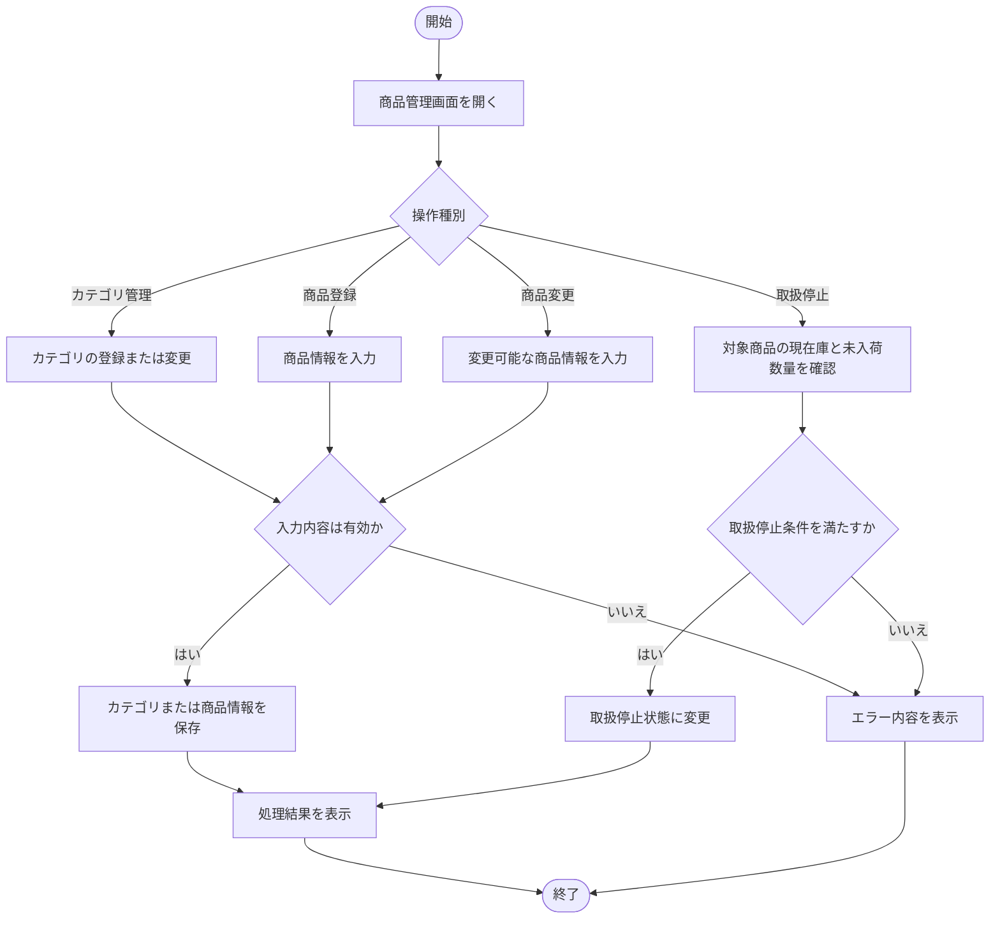

#### 正常系

1. 商品管理画面を開く。
2. 新規登録、変更または取扱停止を選択する。
3. 必要な商品情報を入力する。
4. システムが入力内容および業務ルールを検証する。
5. 商品情報または取扱状態を更新する。

#### 例外系

| 例外                                     | 対応                           |
| ---------------------------------------- | ------------------------------ |
| 商品コードが重複している                 | 登録を拒否する                 |
| 必須項目が未入力                         | 登録を拒否する                 |
| 販売価格・仕入価格が不正                 | 登録を拒否する                 |
| 現在庫が残っている                       | 取扱停止を拒否する             |
| 未入荷数量が残っている                   | 取扱停止を拒否する             |
| 取引履歴が存在する                       | 履歴を保持し、物理削除しない   |
| カテゴリ名が重複している                 | 登録または変更を拒否する       |
| 存在しないカテゴリが指定された           | 商品の登録または変更を拒否する |
| 登録済みの商品コードを変更しようとした   | 変更を拒否する                 |
| 取扱停止商品のコードを再利用しようとした | 登録を拒否する                 |

#### 業務上の補足

カテゴリ名は一意とし、各商品は一つのカテゴリに所属する。

カテゴリの削除および統合は対象外とする。

商品コードは登録後に変更できない。

商品コードは取扱停止後も再利用しない。

商品情報の物理削除は行わず、取扱停止によって管理する。

取扱停止後も過去の販売実績および在庫変動履歴を参照できる。

現在庫または有効な未入荷数量が残っている商品は取扱停止にできない。

初期在庫未登録の商品についても、有効な未入荷数量が存在しないなどの停止条件を満たす場合は取扱停止を許容する。

取扱停止商品の基本情報の変更は許容するが、取扱再開はv1.0.0までの対象外とする。

商品マスタの販売価格および仕入価格を変更しても、登録済みの販売実績金額および入荷時仕入単価を変更しない。

v1.0.0では調達リードタイムおよび安全在庫などの発注関連情報の管理に対応する。

### 7.3 BF-005：通常の販売実績登録

| 項目           | 内容                                                                                                                                                                      |
| -------------- | ------------------------------------------------------------------------------------------------------------------------------------------------------------------------- |
| 目的           | 日常の販売実績を登録し、現在庫に反映する                                                                                                                                  |
| 主担当者       | 店舗スタッフ                                                                                                                                                              |
| 開始条件       | 対象商品の初期在庫登録が完了している                                                                                                                                      |
| 終了条件       | 販売実績、現在庫および在庫変動履歴が更新される                                                                                                                            |
| 関連業務要件   | BR-002, BR-003, BR-004                                                                                                                                                    |
| 関連業務ルール | BRL-003〜BRL-005, BRL-007, BRL-012, BRL-015〜BRL-017, BRL-024, BRL-027〜BRL-029, BRL-032, BRL-034, BRL-044, BRL-049, BRL-057, BRL-058, BRL-060, BRL-065, BRL-067, BRL-082 |

#### 業務フロー図

#### 正常系

1. 販売実績CSVを取得する。
2. 通常登録を選択し、CSVを取り込む。
3. システムがCSV形式、業務日付、商品情報および重複の有無を検証する。
4. 商品ごとの販売数量を集計し、在庫不足が発生しないことを確認する。
5. 担当者が登録内容を確認し、登録を確定する。
6. 登録時点の業務条件を再検証する。
7. 販売実績、現在庫および在庫変動履歴を一体として更新する。
8. 登録結果を表示する。

#### 例外系

| 例外                                         | 対応                                             |
| -------------------------------------------- | ------------------------------------------------ |
| CSV形式が不正                                | 全件の登録を拒否する                             |
| 必須項目が不足                               | 全件の登録を拒否する                             |
| 商品コードが存在しない                       | 全件の登録を拒否する                             |
| 初期在庫が未登録                             | 全件の登録を拒否する                             |
| 販売実績が重複している                       | 全件の登録を拒否する                             |
| 在庫管理開始日前の販売実績が含まれる         | 過去データ登録を案内する                         |
| 未来の業務日付が含まれる                     | 全件の登録を拒否する                             |
| 取扱停止商品が含まれる                       | 全件の登録を拒否する                             |
| 販売数量が現在庫を超える                     | 全件の登録を拒否する                             |
| 登録確定前に在庫状況が変化した               | 再検証し、登録不可の場合は拒否する               |
| 更新処理中に障害が発生                       | 全件の変更を取り消す                             |
| 同一商品・同一販売日の取消済み実績が存在する | 新規登録を拒否し、BF-014による取消解除を案内する |
| 販売数量が0で売上金額が0ではない             | 全件の登録を拒否する                             |
| 登録結果が通信障害などにより不明             | 登録結果を確認し、共通の再送方針に従う           |

#### 業務上の補足

通常販売実績は、商品単位の在庫管理開始日以降かつ現在の業務日付以前の販売実績を対象とする。

販売実績は商品別・日別の単位で管理する。

CSV内および登録済み販売実績との間で、同一商品・同一販売日の重複を認めない。

登録区分および取消状態を問わず重複を判定する。

販売数量および実際の売上金額を登録する。

販売数量0かつ売上金額0の有効な販売実績を登録できる。

販売数量が0の場合は、販売に対応する在庫変動履歴を追加しない。

CSVの一括登録は全件成功または全件失敗とする。

同一商品について異なる販売日の実績がCSV内に複数行存在する場合は、販売数量の合計を考慮して現在庫を検証する。

過去の業務日付を持つ通常販売実績についても、現在庫への反映は処理確定順に行う。

在庫不足が発生した場合は、入荷実績の登録漏れや実在庫との差異などを調査する。

販売実績を登録するためだけに、根拠のない在庫調整を行ってはならない。

登録済み販売実績に入力誤りが判明した場合はBF-014を実施する。

予測入力に影響する販売実績が追加された場合は、関連する需要予測結果の有効性を再判定する。

### 7.4 BF-006：過去の販売実績登録

| 項目           | 内容                                                                                                                                           |
| -------------- | ---------------------------------------------------------------------------------------------------------------------------------------------- |
| 目的           | 売上分析および需要予測に必要な過去データを整備する                                                                                             |
| 主担当者       | 在庫管理担当者                                                                                                                                 |
| 開始条件       | 店舗の在庫管理開始日が設定され、対象商品の初期在庫登録が完了している                                                                           |
| 終了条件       | 過去販売実績が登録され、現在庫および在庫変動履歴は変更されない                                                                                 |
| 関連業務要件   | BR-004, BR-006                                                                                                                                 |
| 関連業務ルール | BRL-007, BRL-012, BRL-014, BRL-024, BRL-027, BRL-029, BRL-031, BRL-034, BRL-044, BRL-049, BRL-054, BRL-060, BRL-065, BRL-067, BRL-079, BRL-082 |

#### 業務フロー図

#### 正常系

1. 在庫管理開始日前の販売実績CSVを準備する。
2. 過去データ登録を選択する。
3. CSVを取り込み、入力内容を検証する。
4. 担当者が登録内容を確認する。
5. 過去の販売実績を登録する。
6. 登録結果を表示する。

#### 例外系

| 例外                                         | 対応                                             |
| -------------------------------------------- | ------------------------------------------------ |
| CSV形式が不正                                | 全件の登録を拒否する                             |
| 商品コードが存在しない                       | 全件の登録を拒否する                             |
| 販売実績が重複している                       | 全件の登録を拒否する                             |
| 在庫管理開始日以降のデータが含まれる         | 通常登録を案内する                               |
| 更新処理中に障害が発生                       | 全件の変更を取り消す                             |
| 初期在庫が未登録                             | 全件の登録を拒否する                             |
| 同一商品・同一販売日の取消済み実績が存在する | 新規登録を拒否し、BF-014による取消解除を案内する |
| 販売数量が0で売上金額が0ではない             | 全件の登録を拒否する                             |

#### 業務上の補足

過去販売実績は商品単位の在庫管理開始日前の販売実績を対象とする。

対象商品の初期在庫登録が完了していることを必要とする。

過去販売実績の登録では現在庫を変更せず、販売に対応する在庫変動履歴も作成しない。

販売実績は商品別・日別の単位で管理する。

通常販売実績および取消済み販売実績との重複についても防止する。

初期在庫登録済みの取扱停止商品についても、過去の取引事実を保持するため、過去販売実績の登録を許容する。

有効な過去販売実績は売上集計および需要予測に利用する。

登録済み販売実績に入力誤りが判明した場合はBF-014を実施する。

予測入力に影響する過去販売実績が追加された場合は、関連する需要予測結果の有効性を再判定する。

### 7.5 BF-007：入荷実績登録

| 項目           | 内容                                                                                                                         |
| -------------- | ---------------------------------------------------------------------------------------------------------------------------- |
| 目的           | 実際に入荷した商品を現在庫に反映する                                                                                         |
| 主担当者       | 在庫管理担当者、店舗スタッフ                                                                                                 |
| 開始条件       | 商品が実際に入荷している                                                                                                     |
| 終了条件       | 現在庫、入荷履歴および必要に応じて未入荷数量が更新される                                                                     |
| 関連業務要件   | BR-002, BR-003, BR-011                                                                                                       |
| 関連業務ルール | BRL-004, BRL-006, BRL-012, BRL-015, BRL-020, BRL-028, BRL-034, BRL-036, BRL-043, BRL-044, BRL-056〜BRL-058, BRL-070〜BRL-074 |

#### 業務フロー図

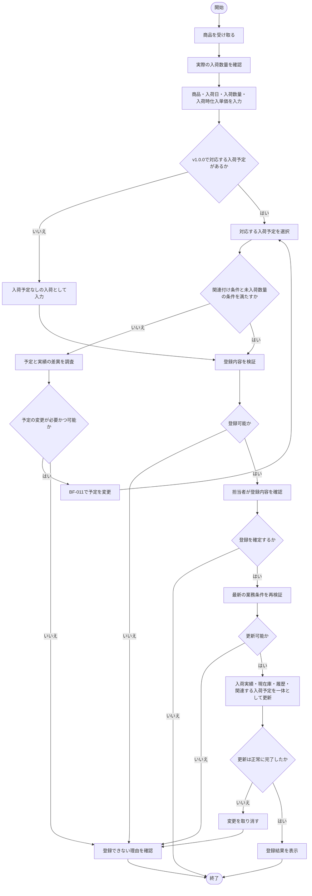

#### 正常系

1. 商品を受け取り、実際の入荷数量を確認する。
2. 対象商品、入荷数量および入荷日を入力する。
3. 対応する入荷予定がある場合は、その予定を選択する。
4. システムが入力内容を検証する。
5. 担当者が登録を確定する。
6. 現在庫を増加させ、入荷履歴を記録する。
7. 入荷予定と関連付けられている場合は、未入荷数量を減少させる。
8. 登録結果を表示する。

#### 例外系

| 例外                                   | 対応                                     |
| -------------------------------------- | ---------------------------------------- |
| 商品が存在しない                       | 登録を拒否する                           |
| 初期在庫が未登録                       | 初期在庫登録を案内する                   |
| 取扱停止商品である                     | 登録を拒否する                           |
| 入荷数量が0以下または整数ではない      | 登録を拒否する                           |
| 未入荷数量を超える入荷                 | 差異を調査し、必要に応じて予定を修正する |
| 取消済みの入荷予定が指定された         | 登録を拒否する                           |
| 入荷完了済みの予定が指定された         | 登録を拒否する                           |
| 更新処理中に障害が発生                 | 関連する変更をすべて取り消す             |
| 入荷日が商品単位の在庫管理開始日より前 | 登録を拒否する                           |
| 入荷日が未来の日付                     | 登録を拒否する                           |
| 入荷時仕入単価が不正                   | 登録を拒否する                           |
| 入荷予定と入荷実績の商品が一致しない   | 関連付けを拒否する                       |
| 登録確定前に未入荷数量が変化した       | 最新の入荷状況を確認して再検証する       |
| 登録結果が不明                         | 登録結果を確認し、共通の再送方針に従う   |

#### リリースごとの取り扱い

v0.1.0では入荷予定との関連付けを行わず、入荷実績、現在庫および在庫変動履歴を管理する。

v1.0.0では入荷予定との関連付けおよび未入荷数量の更新に対応する。

対応する入荷予定が存在しない場合も、実際の入荷事実を登録できるものとする。

入荷実績には実際の入荷時仕入単価を記録する。

入荷時仕入単価の登録によって商品マスタの仕入価格を自動変更しない。

過去の業務日付を持つ入荷実績についても、現在庫への反映は処理確定順に行う。

入荷予定に関連付けた場合は、有効な入荷済み数量、未入荷数量および入荷予定の状態を更新する。

入荷予定日を過ぎていることのみを理由として、実際の入荷実績の登録を拒否しない。

登録済み入荷実績に入力誤りが判明した場合はBF-015を実施する。

### 7.6 BF-008：在庫調整

| 項目           | 内容                                                                                                                         |
| -------------- | ---------------------------------------------------------------------------------------------------------------------------- |
| 目的           | 実在庫とシステム上の在庫数量の差異を訂正する                                                                                 |
| 主担当者       | 在庫管理担当者                                                                                                               |
| 開始条件       | 在庫差異、廃棄、破損などが確認されている                                                                                     |
| 終了条件       | 在庫数量が調整され、調整履歴が記録される                                                                                     |
| 関連業務要件   | BR-002, BR-003                                                                                                               |
| 関連業務ルール | BRL-003, BRL-004, BRL-012, BRL-013, BRL-015, BRL-018, BRL-028, BRL-033, BRL-034, BRL-044, BRL-052, BRL-054, BRL-057, BRL-058 |

#### 業務フロー図

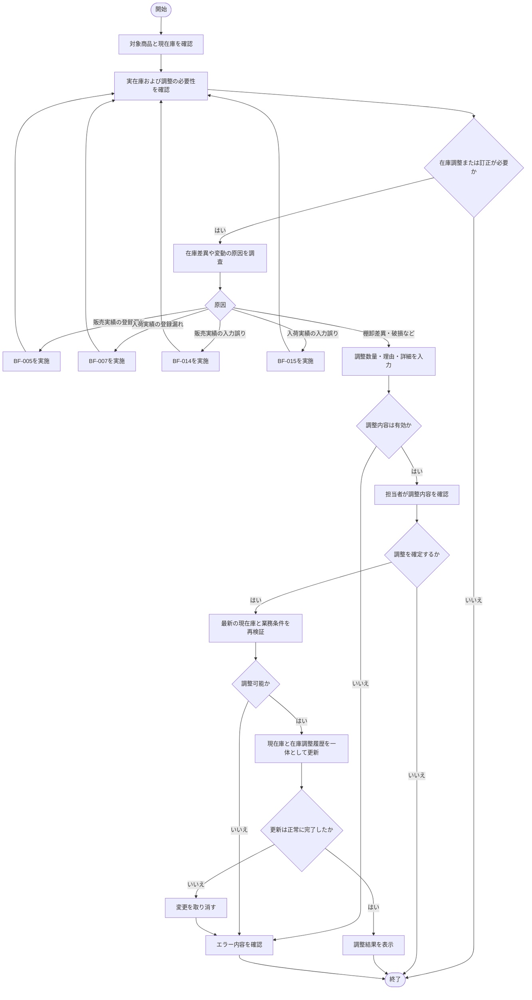

#### 正常系

1. 実在庫とシステム上の現在庫を確認する。
2. 在庫差異の原因を調査する。
3. 調整が必要な場合は、調整数量および調整理由を入力する。
4. システムが調整内容を検証する。
5. 担当者が調整を確定する。
6. 現在庫を更新し、在庫調整履歴を記録する。

#### 例外系

| 例外                           | 対応                               |
| ------------------------------ | ---------------------------------- |
| 調整理由が未入力               | 登録を拒否する                     |
| 調整数量が不正                 | 登録を拒否する                     |
| 調整後の在庫数量が負になる     | 登録を拒否する                     |
| 調整確定前に在庫数量が変化した | 最新の在庫状況を確認して再検証する |
| 更新処理中に障害が発生         | 関連する変更をすべて取り消す       |

#### 業務上の補足

在庫調整は過去の在庫変動履歴を直接変更するものではない。

販売実績の登録漏れや入荷実績の登録漏れが原因である場合は、該当する業務処理を優先する。

在庫調整によって販売実績や売上金額を直接変更しない。

在庫調整は、対象商品が取扱中かつ初期在庫登録済みであることを必要とする。

初期在庫の登録誤りについては、元の初期在庫登録を変更せず、在庫調整によって対応する。

登録済み販売実績または入荷実績の入力誤りについては、原則として対応する実績訂正処理を優先する。

在庫調整では、調整理由に応じた増加または減少の条件を満たすことを必要とする。

調整理由および詳細を記録する。

調整後の現在庫が負となる場合は、在庫調整を成立させない。

### 7.7 BF-009：需要予測

| 項目           | 内容                                                                   |
| -------------- | ---------------------------------------------------------------------- |
| 目的           | 商品ごとの将来需要を予測する                                           |
| 主担当者       | 発注担当者、StockPilot                                                 |
| 開始条件       | 利用者が需要予測の実行を指示する                                       |
| 終了条件       | 商品ごとの予測結果または予測不可・失敗の理由を確認できる               |
| 関連業務要件   | BR-006                                                                 |
| 関連業務ルール | BRL-011, BRL-012, BRL-016, BRL-022, BRL-064〜BRL-066, BRL-078〜BRL-083 |

#### 業務フロー図

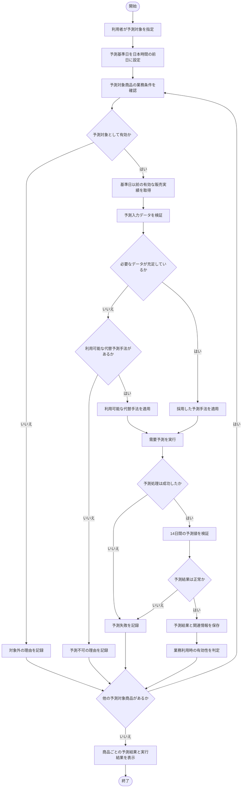

#### 正常系

1. 利用者が需要予測の実行を指示する。
2. 予測基準日を日本時間における前日とする。
3. 対象商品の取扱状態などの業務条件を確認する。
4. 予測基準日以前の有効な販売実績を取得する。
5. 予測に必要なデータ量および品質を確認する。
6. 利用可能な予測手法によって需要予測を実行する。
7. 予測基準日の翌日から14日間の予測値を検証する。
8. 予測結果および予測条件を保存する。
9. 業務利用時の有効性を判定する。
10. 商品ごとの予測結果および実行結果を表示する。

#### 例外系

| 例外                                   | 対応                                                         |
| -------------------------------------- | ------------------------------------------------------------ |
| 予測対象商品が取扱停止状態             | 予測対象から除外する                                         |
| 予測に必要なデータが不足               | 利用可能な代替手法を確認し、予測できない場合は理由を表示する |
| 予測入力データが不正                   | 当該商品の予測を成立させない                                 |
| 予測処理が失敗                         | 当該商品の失敗を記録する                                     |
| 予測値が不足または不正                 | 有効な予測結果として扱わない                                 |
| 予測入力に影響する販売実績が変更された | 関連する予測結果を要再予測として扱う                         |
| 予測基準日などの有効性条件を満たさない | 現在の業務判断に使用しない                                   |

#### 業務上の補足

需要予測は利用者による手動実行を基本とする。

予測基準日より後の販売実績を予測入力に使用しない。

訂正後の有効な通常販売実績および過去販売実績を利用する。

販売実績の未登録を無条件に販売数量0として扱わない。

予測結果は14日間分の0以上の有限な予測値が揃っていることを必要とする。

一部の商品で予測に失敗した場合でも、正常に予測できた商品の結果は保持する。

予測処理の成功と、現在の業務判断に使用できる予測結果の有効性を区別する。

予測結果の有効性は、予測基準日、対象期間および予測入力に影響する変更などに基づいて判定する。

過去の予測結果を参照できることと、現在の発注判断に利用できることを区別する。

最低データ量、データ品質基準および代替予測手法は後続のデータ分析・需要予測工程で決定する。

具体的な実行条件、保存条件および有効性判定の詳細は機能要件定義書に従う。

#### 業務フロー図

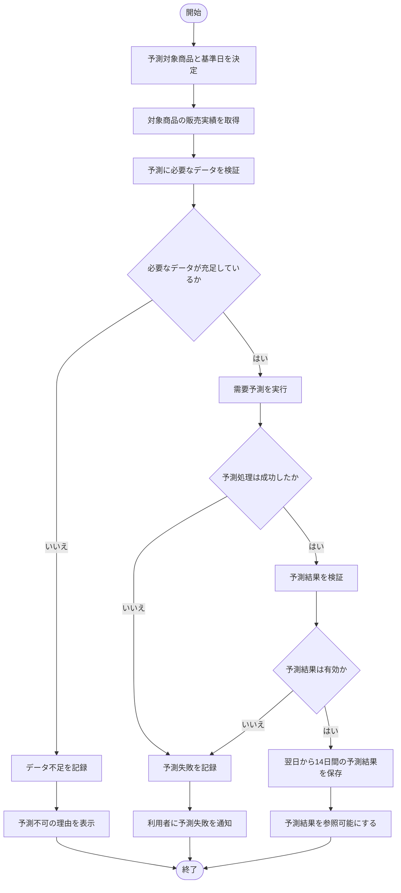

#### 正常系

1. 予測対象商品および予測基準日を決定する。
2. 予測基準日までの利用可能な販売実績を取得する。
3. 予測に必要なデータが充足していることを確認する。
4. 商品別・日別の需要予測を実行する。
5. 予測結果の妥当性を確認する。
6. 予測基準日の翌日から14日間の予測結果を保存する。
7. 予測結果を利用者が参照できる状態にする。

#### 例外系

| 例外                             | 対応                           |
| -------------------------------- | ------------------------------ |
| 販売実績が不足している           | データ不足であることを表示する |
| 予測対象商品が取扱停止状態である | 予測対象から除外する           |
| 予測に必要なデータが不正         | 当該商品の予測を成立させない   |
| 予測処理が失敗した               | 失敗を記録し、利用者に通知する |
| 予測結果が不正                   | 有効な予測結果として公開しない |

#### 業務上の補足

需要予測において、予測基準日より後の情報を利用してはならない。

予測結果には予測基準日、対象期間および予測結果の有効性を判断するための情報を含める。

一部の商品で予測に失敗した場合でも、正常に予測できた商品の結果は利用可能とする。

最低データ量、代替予測手法、予測結果の有効期間および実行頻度は後続工程で具体化する。

### 7.8 BF-010：欠品リスク確認・発注判断

| 項目           | 内容                                                                                              |
| -------------- | ------------------------------------------------------------------------------------------------- |
| 目的           | 欠品および過剰在庫を抑制するための発注判断を支援する                                              |
| 主担当者       | 発注担当者、店長、StockPilot                                                                      |
| 開始条件       | 担当者が欠品リスクの確認または発注判断を行う                                                      |
| 終了条件       | 担当者による発注判断が完了する                                                                    |
| 関連業務要件   | BR-007, BR-008, BR-009, BR-011                                                                    |
| 関連業務ルール | BRL-009〜BRL-011, BRL-016, BRL-021, BRL-026, BRL-038, BRL-039, BRL-076, BRL-077, BRL-083〜BRL-091 |

#### 業務フロー図

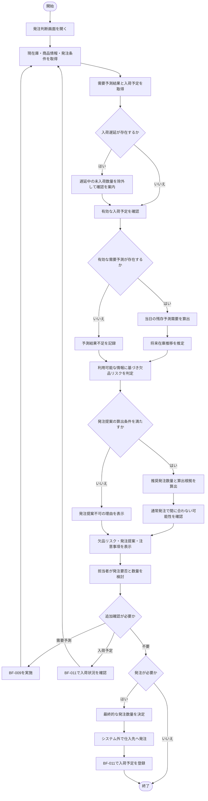

#### 正常系

1. 発注担当者が発注判断画面を開く。
2. 現在庫、商品情報および発注条件を取得する。
3. 需要予測結果の有効性を確認する。
4. 有効な未入荷数量および入荷遅延を確認する。
5. 当日の残存予測需要を算出する。
6. 将来在庫推移を推定する。
7. 欠品リスクを判定する。
8. 推奨発注数量の算出条件を確認する。
9. 算出可能な場合は推奨発注数量および算出根拠を表示する。
10. 通常発注では間に合わない可能性などの注意事項を表示する。
11. 担当者が必要に応じて予測結果や入荷状況を再確認する。
12. 担当者が最終的な発注要否および発注数量を決定する。
13. 発注が必要な場合はシステム外で仕入先へ発注する。
14. 発注済み商品の入荷予定を登録する。

#### 例外系

| 例外                                   | 対応                                                                 |
| -------------------------------------- | -------------------------------------------------------------------- |
| 初期在庫が未登録                       | 現在庫0として扱わず、必要な判定を不可とする                          |
| 有効な予測結果が存在しない             | 将来在庫推移および発注提案に利用せず、再予測または手動判断を案内する |
| 現在庫が0                              | 予測結果の有無にかかわらず欠品リスクありとする                       |
| 調達リードタイムが未設定               | 発注提案不可とする                                                   |
| 安全在庫が未設定                       | 必要な判定および発注提案を不可とする                                 |
| 入荷予定日を過ぎている                 | 遅延中の未入荷数量を計算対象から除外し、確認を案内する               |
| 最短入荷日より前に欠品リスクが存在する | 通常発注では間に合わない可能性を表示する                             |
| 推奨発注数量が0                        | 発注不要と表示する                                                   |
| 発注提案の算出条件を満たさない         | 発注提案不可とし、理由を表示する                                     |
| 取扱停止商品である                     | 欠品リスク判定および発注提案の対象から除外する                       |

#### 業務上の補足

発注判断は原則として1日1回行う。

当日の残存予測需要は、当日の予測需要から当日の有効な登録済み販売数量を減じた値とし、下限を0とする。

登録済み販売数量および入荷済み数量を二重に反映しない。

有効な未入荷数量は入荷予定日に反映する。

入荷遅延中の未入荷数量は、将来在庫推移および発注提案の計算対象外とする。

入荷遅延が解消されない場合でも、その他の有効な情報に基づく業務判断を妨げない。

将来在庫推移の計算上は負数および小数を許容する。

欠品リスクの判定と推奨発注数量の算出可否は区別する。

欠品リスクの判定区分および優先順位は、業務要件定義書の第7.6節および機能要件定義書に従う。

発注判断対象日数は調達リードタイムと発注見直し間隔の合計とする。

推奨発注数量の具体的な算出方法は機能要件定義書のFR-052に従う。

推奨発注数量0と発注提案不可を区別する。

発注不要は欠品リスクが存在しないことを保証するものではない。

発注提案の確認および発注判断のみでは、現在庫や入荷予定を変更しない。

StockPilotは仕入先への発注処理を実行しない。

### 7.9 BF-011：入荷予定管理

| 項目           | 内容                                                                                     |
| -------------- | ---------------------------------------------------------------------------------------- |
| 目的           | 発注済み商品の入荷予定および未入荷数量を管理する                                         |
| 主担当者       | 発注担当者                                                                               |
| 開始条件       | 発注済み商品または登録済みの入荷予定が存在する                                           |
| 終了条件       | 入荷予定の登録・変更・取消が完了する                                                     |
| 関連業務要件   | BR-011                                                                                   |
| 関連業務ルール | BRL-019, BRL-020, BRL-026, BRL-035〜BRL-037, BRL-039, BRL-042, BRL-044, BRL-070〜BRL-077 |

#### 業務フロー図

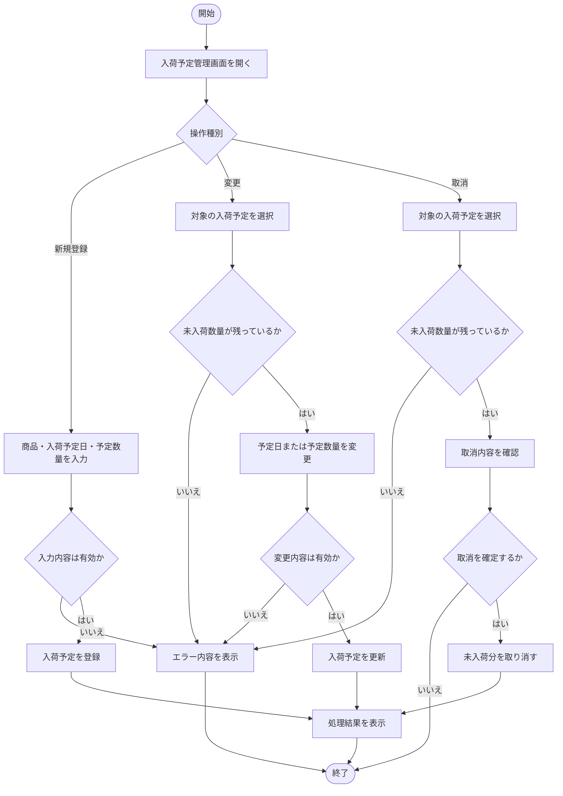

#### 正常系

1. 発注担当者が入荷予定管理画面を開く。
2. 新規登録、変更または取消を選択する。
3. 対象商品、入荷予定日および予定数量を確認する。
4. システムが入力内容および現在の入荷状況を検証する。
5. 入荷予定を登録、更新または取り消す。
6. 処理結果を表示する。

#### 例外系

| 例外                                   | 対応                         |
| -------------------------------------- | ---------------------------- |
| 商品が存在しない                       | 登録を拒否する               |
| 取扱停止商品である                     | 新規登録を拒否する           |
| 予定数量が不正                         | 登録を拒否する               |
| 新規登録時の予定日が過去の日付である   | 登録を拒否する               |
| 変更後の予定数量が入荷済み数量を下回る | 変更を拒否する               |
| 入荷完了済みの予定である               | 変更・取消を拒否する         |
| 取消済みの予定である                   | 変更・再取消を拒否する       |
| 入荷予定日を過ぎている                 | 遅延状態として確認を案内する |

#### 入荷予定の状態遷移

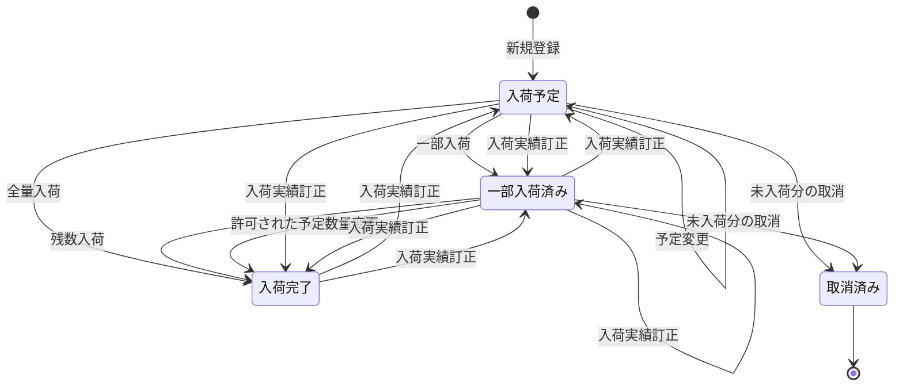

入荷完了からの状態遷移は、許可された入荷実績訂正に伴う状態の再判定によってのみ発生する。

入荷完了状態から通常の予定変更または取消を行うことは認めない。

取消済みの入荷予定に関連する入荷実績の訂正は、v1.0.0の通常操作では認めない。

#### 状態の定義

| 状態         | 定義                                                          |
| ------------ | ------------------------------------------------------------- |
| 入荷予定     | 取消されておらず、入荷済み数量が0であり、未入荷数量が存在する |
| 一部入荷済み | 取消されておらず、一部が入荷済みであり、未入荷数量が存在する  |
| 入荷完了     | 取消されておらず、入荷済み数量と入荷予定数量が一致する        |
| 取消済み     | 未入荷分の取消が確定している                                  |

入荷予定日が現在の業務日付より前であり、有効な未入荷数量が存在する場合は入荷遅延とする。

入荷予定日当日は入荷遅延としない。

入荷遅延は独立した入荷予定状態ではなく、入荷予定に付随する情報として管理する。

#### 業務上の補足

入荷予定はシステム外で実施した発注に基づいて登録する。

入荷予定の登録、変更および取消によって現在庫を変更しない。

取消されていない入荷予定では、以下の数量関係を維持する。

入荷予定数量 = 入荷済み数量 + 未入荷数量

取消済みの入荷予定では、以下の数量関係を維持する。

入荷予定数量 = 入荷済み数量 + 取消数量

取消済みの入荷予定における有効な未入荷数量は0とする。

部分入荷後に未入荷分を取り消した場合も、すでに入荷した数量および入荷履歴を保持する。

実際の入荷が発生した場合はBF-007を実施する。

入荷実績に入力誤りが判明した場合はBF-015を実施する。

許可された入荷実績訂正に伴い、関連する入荷予定の数量および状態を再判定する。

入荷完了、取消済みおよび入荷遅延中の未入荷数量は、将来在庫推移および発注提案の計算対象外とする。

入荷遅延のみを理由として、入荷予定日の自動変更または入荷予定の自動取消を行わない。

担当者が実際の入荷状況を確認し、必要に応じて許可された変更または取消を行う。

### 7.10 BF-012：売上・在庫状況の確認・分析

| 項目           | 内容                                                                            |
| -------------- | ------------------------------------------------------------------------------- |
| 目的           | 売上および在庫状況を把握し、店舗運営に利用する                                  |
| 主担当者       | 店長、在庫管理担当者                                                            |
| 開始条件       | 商品情報または販売・在庫データが登録されている                                  |
| 終了条件       | 対象期間および対象商品の状況を確認できる                                        |
| 関連業務要件   | BR-005                                                                          |
| 関連業務ルール | BRL-012, BRL-014, BRL-023, BRL-048, BRL-051, BRL-060, BRL-064〜BRL-066, BRL-069 |

#### 業務フロー図

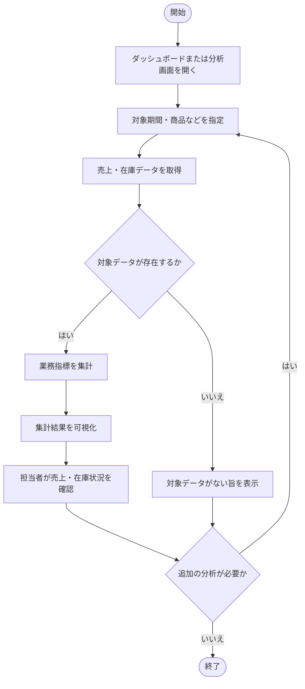

#### 正常系

1. ダッシュボードまたは分析画面を開く。
2. 対象期間や対象商品などを指定する。
3. システムが必要なデータを取得する。
4. 売上金額、販売数量、現在庫数量および在庫金額などを集計する。
5. 集計結果を可視化する。
6. 担当者が店舗運営上の判断に利用する。

#### 例外系

| 例外                   | 対応                             |
| ---------------------- | -------------------------------- |
| 対象データが存在しない | データが存在しない旨を表示する   |
| 対象期間の指定が不正   | 入力内容の修正を案内する         |
| 集計処理が失敗した     | エラーを表示し、再実行を案内する |

#### リリースごとの取り扱い

v0.1.0では基本的な売上・在庫指標をダッシュボードで確認できるものとする。

v1.0.0では売上推移や商品別の販売傾向など、詳細な分析に対応する。

データが存在しない状態と、実績値が0である状態を区別する。

現在庫を表示する指標と、指定期間の売上を表示する指標については、対象時点または対象期間を明示する。

#### 業務上の補足

売上集計には訂正後の有効な通常販売実績および過去販売実績を使用する。

取消済みの販売実績は売上集計の対象外とする。

販売実績の訂正日ではなく、元の販売日を集計の基準日とする。

販売実績が存在しない状態と、有効な販売数量0の実績が存在する状態を区別する。

売上金額には登録済みの実際の売上金額を使用する。

現在の商品マスタの販売価格によって過去の売上金額を再計算しない。

現在庫および概算在庫金額は参照時点の情報として表示する。

売上集計の対象期間を変更しても、現在庫を当該期間末時点の在庫として表示しない。

初期在庫未登録の商品と現在庫数量0の商品を区別する。

現在の概算在庫金額は、現在庫数量と現在の商品マスタの仕入価格に基づいて算出する。

概算在庫金額は会計上の棚卸資産評価額とは区別する。

データが存在しない場合は、データなしであることを利用者に案内する。

具体的な集計条件、表示項目および分析機能の優先度は機能要件定義書に従う。

### 7.11 BF-013：需要予測・業務改善効果の評価

| 項目               | 内容                                                           |
| ------------------ | -------------------------------------------------------------- |
| 目的               | 需要予測精度および業務改善効果を定量的に評価する               |
| 主担当者           | 開発・分析担当者                                               |
| 開始条件           | 評価用データおよび分析環境を準備できる                         |
| 終了条件           | 評価結果、評価上の制約、目標達成状況および改善方針が記録される |
| 関連業務要件       | BR-010                                                         |
| 関連評価指標       | KPI-001〜KPI-004                                               |
| 関連分析・評価要件 | AR-001〜AR-007                                                 |

#### 業務フロー図

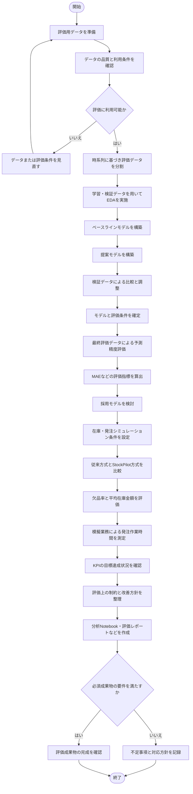

#### 正常系

1. 評価用データセットを準備する。
2. データの出典、利用条件、品質および評価上の制約を確認する。
3. 時系列を考慮して学習、検証および最終評価データを分割する。
4. 学習・検証データを使用して探索的データ分析を実施する。
5. ベースラインモデルを構築する。
6. 提案モデルを構築する。
7. 検証データを使用してモデルの比較および調整を行う。
8. モデルおよび評価条件を確定する。
9. 最終評価データを使用して需要予測精度を評価する。
10. 予測精度、予測可能範囲および業務上の条件を考慮して採用モデルを検討する。
11. 在庫・発注シミュレーションの比較条件を設定する。
12. 従来方式とStockPilot方式を比較する。
13. 欠品率および平均在庫金額を評価する。
14. 模擬業務によって発注作業時間を測定する。
15. KPIの目標達成状況を確認する。
16. 評価結果、制約および改善方針を記録する。
17. 分析・評価成果物の完成条件を確認する。

#### 例外系

| 例外                           | 対応                                           |
| ------------------------------ | ---------------------------------------------- |
| データの品質が不足している     | データの見直しまたは評価条件の再検討を行う     |
| データの利用条件を確認できない | 利用を見合わせる                               |
| 評価に必要な項目が存在しない   | 利用可能な代理値や仮定を検討し、制約を記録する |
| KPIの分母が0                   | 算出不可として記録する                         |
| 発注作業時間を測定できない     | 未測定として理由を記録する                     |
| KPIの目標値を達成できない      | 原因および改善方針を記録する                   |
| 必須の評価作業を実施できない   | 当該成果物要件を原則として未完了とする         |

#### 業務上の補足

モデルの構築および調整では、予測時点より後の情報を使用しない。

最終評価データをモデル選択や調整に使用しない。

需要予測精度はMAEを主指標とし、その他の評価指標および予測可能範囲も確認する。

ベースラインモデルと提案モデルは共通の評価対象に基づいて比較する。

提案モデルの採用を前提とせず、精度、業務改善効果、実行時間、保守性などを考慮して採用モデルを決定する。

在庫・発注シミュレーションでは、比較対象間で共通の需要データ、初期条件および外部条件を使用する。

在庫不足によって満たせなかった需要は、基本方針として販売機会損失として扱う。

実際の需要を直接取得できない場合は、販売実績を需要の代理値として使用することを許容する。

その場合は、欠品によって販売実績が実際の需要を下回る可能性などの制約を記録する。

KPIの算出方法は業務要件定義書および機能要件定義書に従う。

KPIの目標達成状況と分析・評価成果物の完成判定を区別する。

実際の企業への導入効果とシミュレーションによる評価結果を混同しない。

評価処理は利用者向けWebアプリケーションの外部で実施することを許容する。

分析・評価成果物には、評価条件、実行環境および再現手順を記録する。

### 7.12 BF-014：販売実績訂正

| 項目           | 内容                                                                                                       |
| -------------- | ---------------------------------------------------------------------------------------------------------- |
| 目的           | 元の販売実績を保持しながら入力誤りを訂正する                                                               |
| 主担当者       | 店舗スタッフ、在庫管理担当者                                                                               |
| 開始条件       | 登録済み販売実績に入力誤りが判明している                                                                   |
| 終了条件       | 訂正結果および必要な在庫変動が正しく記録される                                                             |
| 関連業務要件   | BR-002, BR-003, BR-004                                                                                     |
| 関連業務ルール | BRL-003〜BRL-005, BRL-007, BRL-012, BRL-014, BRL-018, BRL-027, BRL-028, BRL-044, BRL-057〜BRL-068, BRL-082 |

#### 業務フロー図

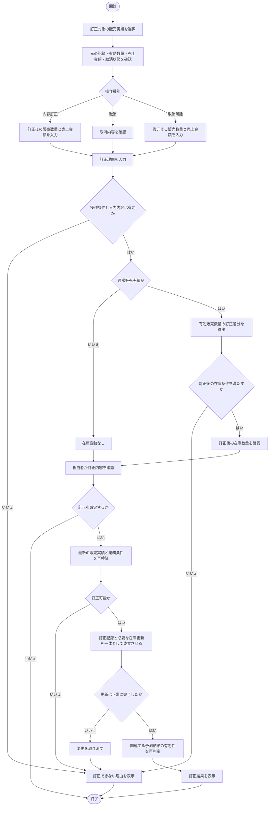

#### 正常系

1. 訂正対象の販売実績を選択する。
2. 元の販売実績および現在の有効な販売実績を確認する。
3. 内容訂正、取消または取消解除を選択する。
4. 操作に応じた訂正内容および訂正理由を入力する。
5. システムが入力内容および操作条件を検証する。
6. 通常販売実績の場合は、訂正前後の有効販売数量の差分を算出する。
7. 過去販売実績の場合は、在庫変動を行わない。
8. 担当者が訂正内容および在庫への影響を確認する。
9. 担当者が訂正を確定する。
10. 最新の販売実績および業務条件を再検証する。
11. 元の販売実績を保持したまま訂正記録を追加する。
12. 必要に応じて現在庫および在庫変動履歴を更新する。
13. 関連する需要予測結果の有効性を再判定する。
14. 訂正結果を表示する。

#### 販売実績の状態遷移

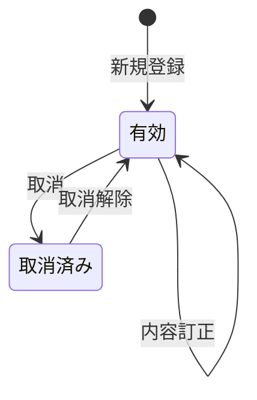

#### 例外系

| 例外                                    | 対応                                 |
| --------------------------------------- | ------------------------------------ |
| 対象販売実績が存在しない                | 訂正を拒否する                       |
| 訂正理由が未入力                        | 訂正を拒否する                       |
| 販売数量または売上金額が不正            | 訂正を拒否する                       |
| 販売数量が0で売上金額が0ではない        | 訂正を拒否する                       |
| 内容訂正の前後で変更が存在しない        | 訂正を拒否する                       |
| 現在の取消状態と操作種別が一致しない    | 訂正を拒否する                       |
| 訂正後の現在庫が負になる                | 訂正を拒否する                       |
| 取扱停止商品の訂正後の現在庫が0ではない | 在庫変動を伴う訂正を拒否する         |
| 訂正確定前に対象データが変更された      | 最新のデータを確認して再検証する     |
| 更新処理中に障害が発生                  | 関連する変更をすべて取り消す         |
| 訂正結果が不明                          | 共通の再送方針に従って結果を確認する |

#### 業務上の補足

販売実績の訂正では元の販売実績を直接上書きまたは削除しない。

訂正前の有効販売数量および売上金額は、それまでの訂正履歴を反映した値とする。

通常販売実績の在庫変動数量は以下の式で算出する。

在庫変動数量 = 訂正前有効販売数量 - 訂正後有効販売数量

取消済み販売実績の有効販売数量および有効売上金額は0として扱う。

過去販売実績の訂正、取消および取消解除では現在庫および在庫変動履歴を変更しない。

売上金額のみの訂正など、在庫数量に変動がない場合は在庫変動履歴を追加しない。

販売数量0の有効な販売実績と取消済みの販売実績を区別する。

取消済みの販売実績は売上集計および需要予測の対象外とする。

取消解除後は有効な販売実績として取り扱う。

訂正後も元の商品、販売日および登録区分を変更しない。

商品または販売日の登録誤りについては、元の販売実績の取消と正しい販売実績の登録などによって対応する。

訂正先に既存の販売実績が存在する場合は、当該実績の訂正または取消解除の必要性を確認する。

複数の業務操作による訂正は、一つの一体的な処理として成立することを保証しない。

売上集計および需要予測では元の販売日を基準とする。

訂正による在庫変動の業務日付は、訂正を実施した業務日付とする。

販売実績の訂正と実際の返品・返金業務を区別する。

### 7.13 BF-015：入荷実績訂正

| 項目           | 内容                                                                                                                         |
| -------------- | ---------------------------------------------------------------------------------------------------------------------------- |
| 目的           | 元の入荷実績を保持しながら入力誤りを訂正する                                                                                 |
| 主担当者       | 在庫管理担当者、店舗スタッフ                                                                                                 |
| 開始条件       | 登録済み入荷実績に入力誤りが判明している                                                                                     |
| 終了条件       | 訂正結果、現在庫、在庫変動履歴および関連する入荷予定が整合している                                                           |
| 関連業務要件   | BR-002, BR-003, BR-011                                                                                                       |
| 関連業務ルール | BRL-003, BRL-004, BRL-006, BRL-012, BRL-018, BRL-020, BRL-028, BRL-042, BRL-044, BRL-055, BRL-057〜BRL-059, BRL-070〜BRL-075 |

#### 業務フロー図

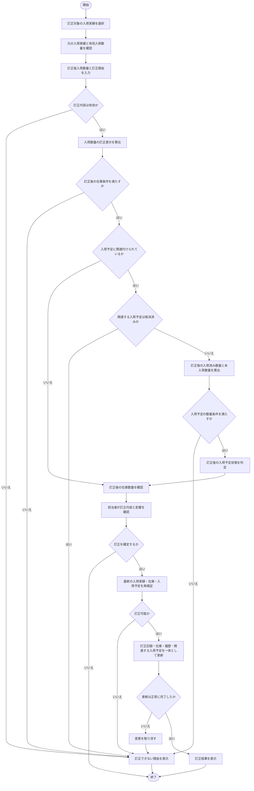

#### 正常系

1. 訂正対象の入荷実績を選択する。
2. 元の入荷実績および現在の有効入荷数量を確認する。
3. 訂正後入荷数量および訂正理由を入力する。
4. システムが入力内容および訂正条件を検証する。
5. 訂正前後の有効入荷数量の差分を算出する。
6. 訂正後の現在庫が業務条件を満たすことを確認する。
7. 入荷予定に関連付けられている場合は、関連する数量および状態への影響を確認する。
8. 担当者が訂正内容を確認する。
9. 担当者が訂正を確定する。
10. 最新の入荷実績、現在庫および関連する入荷予定を再検証する。
11. 元の入荷実績を保持したまま訂正記録を追加する。
12. 現在庫および在庫変動履歴を更新する。
13. 必要に応じて関連する入荷予定の数量および状態を更新する。
14. 訂正結果を表示する。

#### 例外系

| 例外                                       | 対応                                 |
| ------------------------------------------ | ------------------------------------ |
| 対象入荷実績が存在しない                   | 訂正を拒否する                       |
| 訂正後入荷数量が不正                       | 訂正を拒否する                       |
| 訂正理由が未入力                           | 訂正を拒否する                       |
| 訂正後入荷数量が現在の有効入荷数量と同じ   | 訂正を拒否する                       |
| 訂正後の現在庫が負になる                   | 訂正を拒否する                       |
| 取扱停止商品の訂正後の現在庫が0ではない    | 訂正を拒否する                       |
| 関連する入荷予定が取消済み                 | 通常操作による訂正を拒否する         |
| 訂正後の入荷済み数量が入荷予定数量を超える | 訂正を拒否する                       |
| 訂正確定前に関連データが変更された         | 最新のデータを確認して再検証する     |
| 更新処理中に障害が発生                     | 関連する変更をすべて取り消す         |
| 訂正結果が不明                             | 共通の再送方針に従って結果を確認する |

#### 業務上の補足

入荷実績の訂正では元の入荷実績を直接上書きまたは削除しない。

訂正前の有効入荷数量は、それまでの訂正履歴を反映した値とする。

入荷実績訂正による在庫変動数量は以下の式で算出する。

在庫変動数量 = 訂正後入荷数量 - 訂正前有効入荷数量

訂正後入荷数量は0以上の整数とする。

訂正後入荷数量が0の場合は、当該入荷実績の有効入荷数量を0とする。

元の入荷実績および訂正履歴は保持する。

入荷実績訂正では、元の商品、入荷日および入荷時仕入単価を直接変更しない。

これらの項目に入力誤りがある場合は、元の入荷実績の有効数量を0とする訂正と、正しい入荷実績の登録による対応を検討する。

いずれの操作も、現在庫および関連する入荷予定の業務条件を満たすことを必要とする。

複数の業務操作による訂正は、一つの一体的な処理として成立することを保証しない。

訂正による在庫変動の業務日付は、訂正を実施した業務日付とする。

v0.1.0では入荷実績、訂正記録、現在庫および在庫変動履歴を管理する。

v1.0.0では関連する入荷予定の入荷済み数量、未入荷数量および状態の再判定に対応する。

入荷完了済みの入荷予定についても、許可された入荷実績訂正に伴う状態の再判定を認める。

取消済みの入荷予定に関連する入荷実績の訂正は、v1.0.0の通常操作では認めない。

例外的な訂正運用については、業務要件定義書のTBD-015で管理する。

## 8. 業務とデータ更新の対応関係

### 8.1 データ更新一覧

| 業務フロー             | 商品情報 | 販売実績         | 入荷実績   | 現在庫       | 在庫変動履歴 | 訂正記録 | 入荷予定     | 需要予測結果 |
| ---------------------- | -------- | ---------------- | ---------- | ------------ | ------------ | -------- | ------------ | ------------ |
| BF-003：初期導入       | 更新     | ―                | ―          | 設定         | 追加         | ―        | ―            | ―            |
| BF-004：商品管理       | 更新     | ―                | ―          | ―            | ―            | ―        | ―            | 有効性確認   |
| BF-005：通常販売登録   | ―        | 追加             | ―          | 減少         | 条件付き追加 | ―        | ―            | 有効性再判定 |
| BF-006：過去販売登録   | ―        | 追加             | ―          | ―            | ―            | ―        | ―            | 有効性再判定 |
| BF-007：入荷実績登録   | ―        | ―                | 追加       | 増加         | 追加         | ―        | 条件付き更新 | ―            |
| BF-008：在庫調整       | ―        | ―                | ―          | 増減         | 追加         | ―        | ―            | ―            |
| BF-009：需要予測       | ―        | ―                | ―          | ―            | ―            | ―        | ―            | 保存・更新   |
| BF-010：発注判断       | ―        | ―                | ―          | ―            | ―            | ―        | ―            | ―            |
| BF-011：入荷予定管理   | ―        | ―                | ―          | ―            | ―            | ―        | 更新         | ―            |
| BF-012：売上・在庫分析 | ―        | ―                | ―          | ―            | ―            | ―        | ―            | ―            |
| BF-013：効果検証       | ―        | ―                | ―          | ―            | ―            | ―        | ―            | ―            |
| BF-014：販売実績訂正   | ―        | 有効値・状態更新 | ―          | 条件付き増減 | 条件付き追加 | 追加     | ―            | 有効性再判定 |
| BF-015：入荷実績訂正   | ―        | ―                | 有効値更新 | 増減         | 追加         | 追加     | 条件付き更新 | ―            |

本表は各業務フローが直接取り扱う主要な業務データを示す。

他の業務フローを呼び出した場合のデータ更新については、呼び出し先の業務フローに従う。

BF-003では、上記に加えて利用アカウント、店舗の在庫管理開始日および商品単位の在庫管理開始日を取り扱う。

BF-004ではカテゴリ情報も取り扱う。

BF-005およびBF-006ではCSV登録結果などの関連情報も記録する。

販売実績および入荷実績の有効値更新は、元の業務記録の直接上書きを意味しない。

需要予測結果の有効性再判定は、予測結果そのものの再計算を意味しない。

有効性判定を保存するか参照時に算出するかなどの具体的な実現方式は基本設計で決定する。

BF-013では、業務データとは別に分析Notebook、評価レポートなどの成果物を作成する。

### 8.2 データ整合性の維持

以下の関連するデータ更新は一体として成立するものとする。

| 業務             | 一体として成立させるデータ更新                                 |
| ---------------- | -------------------------------------------------------------- |
| 初期在庫登録     | 商品単位の在庫管理開始日、初期在庫、在庫変動履歴               |
| 通常販売実績登録 | CSV内の販売実績、現在庫、必要な在庫変動履歴                    |
| 過去販売実績登録 | CSV内の販売実績                                                |
| 入荷実績登録     | 入荷実績、現在庫、在庫変動履歴、関連する入荷予定               |
| 在庫調整         | 現在庫、在庫変動履歴                                           |
| 通常販売実績訂正 | 訂正記録、有効販売実績、現在庫、必要な在庫変動履歴             |
| 過去販売実績訂正 | 訂正記録、有効販売実績                                         |
| 入荷実績訂正     | 訂正記録、有効入荷実績、現在庫、在庫変動履歴、関連する入荷予定 |
| 入荷予定管理     | 予定数量、入荷済み数量、未入荷数量、取消数量および関連する状態 |

関連するデータ更新の一部のみが成立することを認めない。

更新処理が失敗した場合は、当該処理による変更をすべて取り消す。

現在庫数量が負となる更新を認めない。

通常販売実績および過去販売実績のCSV一括登録は全件成功または全件失敗とする。

需要予測は商品単位の結果を管理し、一部の商品における予測失敗によって正常な他商品の予測結果を一律に無効化しない。

販売実績の変更後に、変更前の予測入力に基づく無効な予測結果を現在の業務判断に使用しない。

同時操作および通信再送による不整合を防止する。

具体的なトランザクション境界、排他制御、重複防止方式および保存方式は基本設計で決定する。

## 9. 例外処理方針

### 9.1 CSV一括登録

通常販売実績および過去販売実績の登録では、全件成功または全件失敗の方式を採用する。

CSV内に登録できないデータが1件以上存在する場合は、当該CSVのすべての登録を拒否する。

担当者がエラーの原因を特定できるように、可能な範囲で対象行、対象項目およびエラー理由を提示する。

登録確定時には最新の業務条件に基づいて再検証する。

### 9.2 販売実績の登録区分

商品単位の在庫管理開始日を基準として販売実績を以下のように区分する。

| 区分         | 対象業務日付                 | 現在庫への反映 |
| ------------ | ---------------------------- | -------------- |
| 通常販売実績 | 商品単位の在庫管理開始日以降 | あり           |
| 過去販売実績 | 商品単位の在庫管理開始日前   | なし           |

いずれの登録区分も対象商品の初期在庫登録が完了していることを必要とする。

未来の業務日付を持つ販売実績は登録できない。

一つのCSVに選択した登録区分と一致しない販売実績が含まれる場合は、全件の登録を拒否する。

必要に応じて担当者にCSVの分割を案内する。

### 9.3 在庫不足

通常販売実績の登録、在庫調整または実績訂正によって現在庫が負になる場合は、当該処理を成立させない。

担当者は入荷実績の登録漏れ、販売実績の重複、入力誤りおよび実在庫との差異などを調査する。

根拠のない在庫調整によって在庫不足を解消してはならない。

### 9.4 重複登録および再送

販売実績は同一商品・同一販売日の単位で重複を判定する。

通常販売実績と過去販売実績の登録区分および取消状態を問わず重複を防止する。

入荷実績、在庫調整および実績訂正についても、通信障害や操作の繰り返しによる意図しない二重登録を防止する。

処理結果が不明な場合は、同一操作の再送に関する共通機能要件に従う。

既に成立した同一操作について、業務データを重複して更新しない。

具体的な操作識別子および再送時の処理方式は基本設計で決定する。

### 9.5 部分入荷および入荷予定の取消

予定数量の一部のみが入荷した場合は、実際に入荷した数量だけを現在庫に加算する。

残りの有効な未入荷数量は入荷予定として管理する。

未入荷分が取り消された場合は、取消分を将来在庫推移および発注提案の計算対象から除外する。

すでに登録された入荷実績および在庫変動履歴は保持する。

### 9.6 需要予測データ不足および無効な予測結果

需要予測に必要なデータが不足している場合は、その旨を利用者に提示する。

予測結果が存在しない状態を予測需要0として扱わない。

利用可能な代替予測手法が存在する場合は、その適用条件に従う。

現在の業務判断に必要な有効性条件を満たさない予測結果は、将来在庫推移および発注提案に使用しない。

必要に応じて再予測または担当者による手動判断を案内する。

### 9.7 システム障害

処理中にシステム障害が発生した場合は、不整合な業務データを残さない。

処理が成立していない場合に成功として表示しない。

処理結果が不明な場合は、失敗と断定せず、結果の確認を案内する。

利用者が処理の成功・失敗を確認できるようにする。

### 9.8 同時操作によるデータ変更

登録または訂正の確認後に関連する業務データが変更された場合は、最新の状態に基づいて業務条件を再検証する。

古い確認内容に基づいて不正な更新を成立させない。

必要に応じて最新のデータを表示し、利用者による再確認を案内する。

### 9.9 実績訂正

販売実績および入荷実績の入力誤りには、定義された訂正処理によって対応する。

元の業務記録および在庫変動履歴を直接編集または削除しない。

訂正処理では元の記録、訂正内容および訂正理由を保持する。

訂正によって現在庫または関連する入荷予定が業務条件を満たさなくなる場合は、当該訂正を成立させない。

取消済み入荷予定に関連する入荷実績の訂正は通常操作では認めない。

### 9.10 入荷遅延

入荷予定日が現在の業務日付より前であり、有効な未入荷数量が存在する場合は入荷遅延とする。

遅延中の未入荷数量は将来在庫推移および発注提案の計算対象外とする。

担当者に実際の入荷状況の確認を案内する。

入荷遅延のみを理由として、予定日の自動変更または入荷予定の自動取消を行わない。

### 9.11 初期在庫未登録および取扱停止

初期在庫未登録の商品を現在庫数量0の商品として扱わない。

初期在庫登録が必要な業務については、対象商品の初期在庫登録を案内する。

取扱停止商品については、過去の業務記録の参照および許可された業務操作のみを認める。

### 9.12 欠品リスク判定不可および発注提案不可

欠品リスクの判定不可とリスク検出なしを区別する。

発注提案不可と推奨発注数量0を区別する。

必要な情報が不足している場合は、不足している情報および対応方法を案内する。

欠品リスク判定および発注提案の結果は、実際の需要や欠品の発生を保証するものではない。

## 10. 業務要件との対応関係

| 業務要件ID | 業務要件                     | 主な関連業務フロー                             |
| ---------- | ---------------------------- | ---------------------------------------------- |
| BR-001     | 商品情報の一元管理           | BF-003, BF-004                                 |
| BR-002     | 現在庫の把握                 | BF-003, BF-005, BF-007, BF-008, BF-014, BF-015 |
| BR-003     | 入出庫履歴の把握             | BF-003, BF-005, BF-007, BF-008, BF-014, BF-015 |
| BR-004     | 販売実績の効率的な登録       | BF-003, BF-005, BF-006, BF-014                 |
| BR-005     | 売上・在庫状況の可視化       | BF-012                                         |
| BR-006     | 将来の商品需要の予測         | BF-006, BF-009                                 |
| BR-007     | 欠品リスクの把握             | BF-010                                         |
| BR-008     | 発注数量の提案               | BF-010                                         |
| BR-009     | 発注判断の根拠の確認         | BF-010                                         |
| BR-010     | 需要予測と業務改善効果の評価 | BF-013                                         |
| BR-011     | 入荷予定の把握               | BF-007, BF-010, BF-011, BF-015                 |

BF-001はStockPilot導入前の業務フローであるため、直接対応する業務要件を持たない。

BF-002は導入後の業務全体を示す上位業務フローとして扱う。

本表は業務要件と主な業務フローの対応関係を示す。

間接的な関連を含む詳細な業務ルール、機能要件およびテストケースとの対応関係は、機能要件定義書および後続の要件トレーサビリティマトリクスで管理する。

## 11. 未決事項

### 11.1 管理方針

業務フロー定義工程で発生した未決事項には、BF-TBD-XXX形式の一意の識別子を付与する。

未決事項の状態は、決定済み、一部決定および未決定の3種類とする。

決定済みとなった事項についても、識別子および決定内容を保持する。

業務要件定義書および機能要件定義書で管理する事項との対応関係を記録する。

### 11.2 未決事項および決定状況

| ID         | 管理事項                                             | 状態     | 決定内容・残課題                                                     | 関連事項                  |
| ---------- | ---------------------------------------------------- | -------- | -------------------------------------------------------------------- | ------------------------- |
| BF-TBD-001 | CSVの項目、形式および登録可能件数                    | 一部決定 | 基本項目と入力形式は決定済み。容量および行数の妥当性確認が必要       | TBD-001                   |
| BF-TBD-002 | 販売実績の具体的な重複判定方法                       | 決定済み | 同一商品・同一販売日を重複と判定する                                 | TBD-002                   |
| BF-TBD-003 | 登録済み販売実績の訂正手順                           | 決定済み | BF-014によって内容訂正、取消および取消解除を行う                     | TBD-003                   |
| BF-TBD-004 | 需要予測の実行頻度および結果の有効期間               | 一部決定 | 手動実行、予測基準日および有効性判定方針は決定済み。実現方式は未決定 | TBD-013                   |
| BF-TBD-005 | 需要予測に必要な最低データ量                         | 未決定   | データ量および品質基準をデータ分析・需要予測工程で決定する           | TBD-005                   |
| BF-TBD-006 | 予測データ不足時の代替予測手法                       | 未決定   | 利用可能な代替予測手法および適用条件を決定する                       | TBD-006                   |
| BF-TBD-007 | 推奨発注数量の具体的な算出方法                       | 一部決定 | 初期算出方式は決定済み。在庫シミュレーションによる妥当性確認が必要   | TBD-007                   |
| BF-TBD-008 | 欠品リスクの具体的な判定基準                         | 決定済み | 判定区分および基本的な判定条件を決定済み                             | TBD-008                   |
| BF-TBD-009 | 在庫金額の具体的な評価方法                           | 決定済み | 現在の概算在庫金額と評価用の平均在庫金額を区別する                   | TBD-010                   |
| BF-TBD-010 | KPIの評価条件および比較方式                          | 一部決定 | 基本算出方法は決定済み。具体的な比較条件は未決定                     | TBD-012                   |
| BF-TBD-011 | 入荷実績の訂正方法および関連する未入荷数量の扱い     | 決定済み | BF-015によって訂正し、関連する入荷予定の数量と状態を再判定する       | TBD-009                   |
| BF-TBD-012 | 同時操作および通信再送時の二重登録防止方法           | 一部決定 | 共通の業務方針は決定済み。具体的な制御方式は基本設計で決定する       | CFR-003, CFR-004          |
| BF-TBD-013 | 過去の業務日付を持つ通常登録・入荷登録の取り扱い     | 決定済み | 商品単位の開始日以降の登録を許容し、処理確定順に現在庫へ反映する     | BRL-050, BRL-057, BRL-058 |
| BF-TBD-014 | 入荷遅延中の未入荷数量の取り扱い                     | 決定済み | 将来在庫推移および発注提案の計算対象外とし、入荷状況の確認を案内する | BRL-039, BRL-076, BRL-077 |
| BF-TBD-015 | 取消済み入荷予定に関連する入荷実績の例外的な訂正運用 | 未決定   | 通常操作では訂正を認めない。例外的な運用方法は後続工程で検討する     | TBD-015                   |

### 11.3 後続工程での管理

業務要件定義書および機能要件定義書に記載した関連事項についても、引き続き後続工程で管理する。

同一の未決事項については、関連するドキュメント間で決定内容および決定状況の整合性を維持する。

技術的な実現方式については非機能要件定義および基本設計で決定する。

データセット、予測モデルおよび評価条件に関する事項は、データ分析・需要予測工程で決定する。

## 12. 完了条件

以下の条件を満たすことを業務フロー定義の完了条件とする。

- As-IsおよびTo-Beの業務フローが定義されていること。
- 個別業務フローに一意の識別子が付与されていること。
- 業務フローの開始条件および終了条件が明確であること。
- 利用者とシステムの役割が明確であること。
- 正常系および主要な例外系が定義されていること。
- 業務要件および業務ルールとの対応関係が明確であること。
- 業務とデータ更新の対応関係が明確であること。
- リリースごとの対象範囲が明確であること。
- 未決事項および決定予定工程が明記されていること。
- プロジェクト企画書および業務要件定義書との矛盾がないこと。
- Mermaidによる業務フロー図が正常に表示されること。
- 店舗単位および商品単位の在庫管理開始日が業務フローに反映されていること。
- 販売実績訂正および入荷実績訂正の業務フローが定義されていること。
- 販売実績および入荷予定の状態遷移が定義されていること。
- 実績訂正に伴う現在庫および関連する業務データの更新条件が明確であること。
- 需要予測結果の有効性および発注提案不可時の業務手順が明確であること。
- 入荷遅延時の業務手順および計算上の取り扱いが明確であること。
- 分析・評価成果物の要件と業務改善効果の評価フローが整合していること。
- 機能要件定義書との矛盾がないこと。

## 13. 改訂履歴

| バージョン | 日付       | 変更内容                                                                                                                               |
| ---------- | ---------- | -------------------------------------------------------------------------------------------------------------------------------------- |
| 1.0        | 2026-11-27 | 初版作成                                                                                                                               |
| 1.1        | 2026-11-27 | 機能要件定義および業務要件定義書v1.2に伴い、既存業務フロー、状態遷移、データ更新、例外処理および未決事項を更新し、BF-014とBF-015を追加 |
| 1.2        | 2026-11-27 | 最終横断レビューに伴いAs-Is終了条件、販売実績登録の補足、入荷予定の状態遷移および業務要件との対応表を修正                              |
